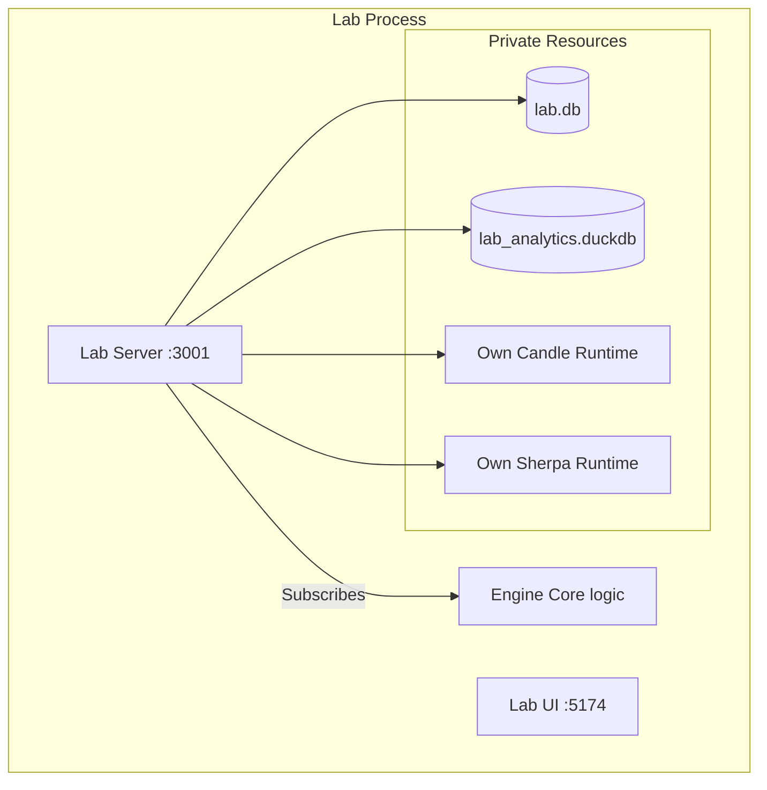

# DevPulse Lab (Internal)

> **CRITICAL ARCHITECTURAL MANDATE**  
> *This document defines the strict requirements for the properties and behavior of the Lab environment. Any code contributing to `alpha/lab` must adhere to these invariants without exception.*

---

## 🛑 The "Senior Dev" Checklist

**Before opening any PR or modifying this codebase, you must verify:**

### 1. Isolated Persistence
- [ ] **Own libSQL Instance**: Lab MUST operate its own `libSQL` database (`lab.db`), completely separate from the production engine's database. It may *read* production data via the Engine facade, but it must persist its own experiments and configuration separately.
- [ ] **Own DuckDB Instance**: Lab MUST maintain its own `DuckDB` instance (`lab_analytics.duckdb`) for high-performance signal analysis, independent of the user's local analytics.

### 2. Independent AI Runtimes
- [ ] **Independent Model System**: Lab MUST instantiate its own model loading runtime (Candle/GGUF). It must NOT rely on the user's running Desktop process. It should be able to load, unload, and test models in isolation.
- [ ] **Independent Voice System**: Lab MUST run its own instance of the Sherpa (OnnxRuntime) voice backend. It must be able to process audio data, synthesize speech, and run benchmarks without contending with the main application's voice resources.

### 3. "Junior Dev" Visuals & Workflow
- [ ] **Simplicity First**: Data visualization (signals, lanes, metrics) must be immediately intuitive. Complex internal states must be rendered as simple, readable dashboards. 
- [ ] **Zero Config Start**: The Lab must be runnable with a single command (`cargo run -p lab`) and require no manual setup of databases or config files.

### 4. Documentation & Planning
- [ ] **Internal Documentation**: All planning, experiments, and management docs belong in `alpha/lab/docs/` or directly in this README's "Status" section.
- [ ] **Architecture Records**: Significant decisions must be recorded in `ARCHITECTURAL_DECISION_RECORDS.md`.

---

## Architecture

Lab constitutes a **Parallel Observer** architecture. It runs alongside the main Engine logic but maintains its own state and resources.



## Quick Start

```bash
# 1. Start the Backend (Runs on :3001)
cargo run -p lab

# 2. Start the UI (Runs on :5174)
cd ui && npm run dev
```

## Status & Roadmap

| Component | Status | Mandate Check |
|-----------|--------|---------------|
| **Database** | 🟢 Ready | `lab.db` verified |
| **Analytics** | 🟢 Ready | `lab_analytics.duckdb` verified |
| **Signals** | 🟢 Ready | Real-time SSE verified |
| **Voice** | 🟢 Ready | Independent Sherpa instance verified |
| **Sub-Agents** | 🔴 Stub | Needs implementation |
| **Docs** | 🟡 Partial | `docs/` folder needed |

## Contributing

1. **Keep it Simple**: If a dashboard requires explanation, it is failed design.
2. **Keep it Isolated**: Never couple Lab logic to Desktop logic. Lab observes; Desktop serves.
3. **Keep it Documented**: If you build it, write a spec in `docs/`.

---

*This tool is the "Ground Truth" for the system. It must be more reliable than the system it watches.*
