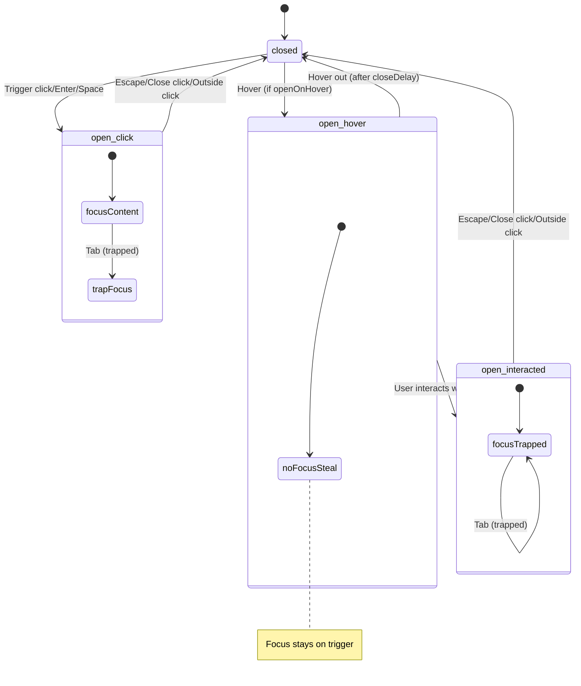

# Popover Primitive — Accessibility Contract

> Non-modal floating content for ColdLight design system.
> Based on [WAI-ARIA Disclosure Pattern](https://www.w3.org/WAI/ARIA/apg/patterns/disclosure/).

## Key Difference from Dialog

- **Non-modal**: No `aria-modal`, no mandatory focus trap
- **Positioned**: Floats relative to trigger element using Floating UI
- **Hover support**: Can open on hover with configurable delays
- **Conditional focus trap**: Only traps focus after user interaction

## ARIA Behavior

| Attribute | Element | Value | Source |
|-----------|---------|-------|--------|
| `aria-haspopup` | Trigger | `"dialog"` | Bits UI |
| `aria-expanded` | Trigger | `"true"` / `"false"` | Bits UI |
| `aria-controls` | Trigger | Content ID (when open) | Bits UI |

**Note:** Content does NOT have `role="dialog"` or `aria-modal` — popovers are non-modal.

## Keyboard Interaction

| Key | Action |
|-----|--------|
| `Enter` / `Space` | Opens popover (on trigger) |
| `Escape` | Closes popover (configurable via `closeOnEscape`) |
| `Tab` | Move focus (NOT trapped by default until user interacts) |

## Focus Management

### Focus Behavior by Open Mode

| Open Mode | Initial Focus | Focus Trap | Return Focus |
|-----------|---------------|------------|--------------|
| **Click** | First focusable in content | Yes | Trigger |
| **Hover** | None (stays on trigger) | No | N/A |
| **Hover → Interact** | Where user clicked | Yes | Trigger |

## Data Attributes

| Attribute | Values | Purpose |
|-----------|--------|---------|
| `data-kind` | `"popover"` | CSS primitive targeting |
| `data-slot` | `"root"` `"trigger"` `"portal"` `"overlay"` `"content"` `"close"` `"arrow"` | CSS slot targeting |
| `data-state` | `"open"` `"closed"` | CSS state targeting |
| `data-side` | `"top"` `"right"` `"bottom"` `"left"` | Position side (from Bits UI) |
| `data-align` | `"start"` `"center"` `"end"` | Position alignment (from Bits UI) |
| `data-id` | User-defined | Testing/tooling |

## Positioning Props

| Prop | Type | Default | Description |
|------|------|---------|-------------|
| `side` | `"top"` \| `"right"` \| `"bottom"` \| `"left"` | `"bottom"` | Preferred side |
| `sideOffset` | `number` | `4` | Distance from anchor |
| `align` | `"start"` \| `"center"` \| `"end"` | `"center"` | Alignment on side |
| `alignOffset` | `number` | `0` | Offset from alignment |
| `avoidCollisions` | `boolean` | `true` | Flip to avoid edges |
| `collisionPadding` | `number` | `8` | Viewport padding |

## Hover Props

| Prop | Type | Default | Description |
|------|------|---------|-------------|
| `openOnHover` | `boolean` | `false` | Enable hover-to-open |
| `openDelay` | `number` | `700` | Delay before opening (ms) |
| `closeDelay` | `number` | `300` | Delay before closing (ms) |

## Screen Reader Announcements

1. When trigger is focused: "Button, popup dialog" announced
2. When expanded: Content becomes navigable
3. Focus indicator visible on all interactive elements

## Testing Requirements

### ARIA
- [ ] Trigger has `aria-haspopup="dialog"`
- [ ] Trigger has `aria-expanded="false"` when closed
- [ ] Trigger has `aria-expanded="true"` when open
- [ ] Trigger has `aria-controls` pointing to content when open
- [ ] Content does NOT have `aria-modal`

### Focus
- [ ] Click-to-open: Focus moves to content
- [ ] Hover-to-open: Focus does NOT move
- [ ] After interaction: Focus trapped within content
- [ ] On close: Focus returns to trigger

### Keyboard
- [ ] Enter/Space on trigger opens
- [ ] Escape closes (when enabled)
- [ ] Tab navigation works inside popover

### Positioning
- [ ] Content positions on correct side
- [ ] Content respects sideOffset
- [ ] Content flips when colliding with viewport

### Data Attributes
- [ ] All slots have `data-kind="popover"`
- [ ] All slots have correct `data-slot`
- [ ] `data-state` changes on open/close
- [ ] `data-side` and `data-align` present on content
