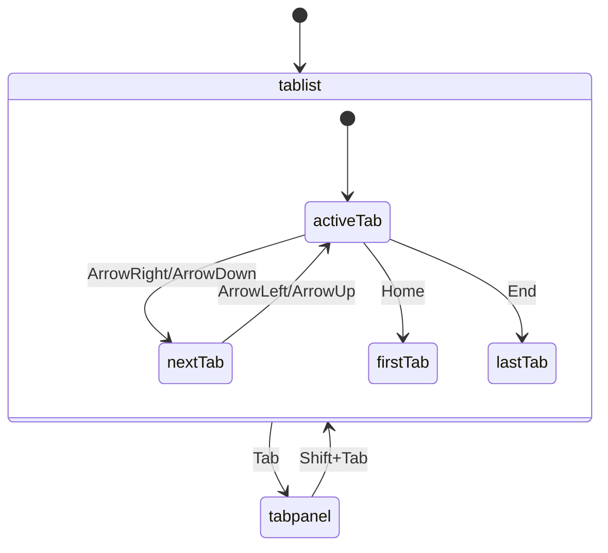

# Tabs Primitive — Accessibility Contract

> ARIA-compliant tabs for ColdLight design system.
> Based on [WAI-ARIA Tabs Pattern](https://www.w3.org/WAI/ARIA/apg/patterns/tabs/).

## ARIA Behavior

| Attribute | Element | Value | Source |
|-----------|---------|-------|--------|
| `role` | List | `tablist` | Bits UI |
| `role` | Trigger | `tab` | Bits UI |
| `role` | Content | `tabpanel` | Bits UI |
| `aria-selected` | Trigger | `true/false` | Bits UI |
| `aria-controls` | Trigger | Content ID | Bits UI |
| `aria-labelledby` | Content | Trigger ID | Bits UI |
| `aria-orientation` | List | `horizontal/vertical` | Bits UI |
| `tabindex` | Trigger | `0/-1` | Bits UI (roving) |
| `tabindex` | Content | `0` | Bits UI |

## Keyboard Interaction

### Horizontal Orientation (default)

| Key | Action |
|-----|--------|
| `ArrowRight` | Move focus to next tab |
| `ArrowLeft` | Move focus to previous tab |
| `Home` | Move focus to first tab |
| `End` | Move focus to last tab |
| `Enter` / `Space` | Activate focused tab (manual mode only) |
| `Tab` | Move focus out of tablist to content |

### Vertical Orientation

| Key | Action |
|-----|--------|
| `ArrowDown` | Move focus to next tab |
| `ArrowUp` | Move focus to previous tab |
| `Home` | Move focus to first tab |
| `End` | Move focus to last tab |
| `Enter` / `Space` | Activate focused tab (manual mode only) |
| `Tab` | Move focus out of tablist to content |

## Focus Management



1. **Initial focus:** Tab into tablist focuses the active tab trigger
2. **Roving tabindex:** Only active/focused tab has `tabindex="0"`, others have `-1`
3. **Activation modes:**
   - `automatic`: Tab activates on focus (default)
   - `manual`: Tab activates on Enter/Space
4. **Loop behavior:** When `loop={true}`, arrow keys wrap at ends

## Data Attributes

| Attribute | Values | Purpose |
|-----------|--------|---------|
| `data-kind` | `"tabs"` | CSS primitive targeting |
| `data-slot` | `"root"` `"list"` `"trigger"` `"content"` | CSS slot targeting |
| `data-state` | `"active"` `"inactive"` | CSS state targeting |
| `data-value` | string | Target specific tabs by value |
| `data-orientation` | `"horizontal"` `"vertical"` | Layout direction |
| `data-id` | User-defined | Testing/tooling |

## CSS Targeting

```css
/* Active tab trigger */
[data-kind="tabs"][data-slot="trigger"][data-state="active"] {
  border-bottom-color: var(--accent);
}

/* Inactive tab trigger */
[data-kind="tabs"][data-slot="trigger"][data-state="inactive"] {
  opacity: 0.7;
}

/* Vertical tabs list */
[data-kind="tabs"][data-slot="list"][data-orientation="vertical"] {
  flex-direction: column;
}

/* Specific tab content by value */
[data-kind="tabs"][data-slot="content"][data-value="settings"] {
  padding: var(--spacing-lg);
}
```

## Screen Reader Behavior

- Announces "tab, 1 of 3" (position in tablist)
- Announces "selected" for active tab
- Announces tab label/content
- Panel content announced when focused

## VPB Use Cases

### Property Inspector Tabs

```svelte
<Tabs.Root value={activePanel}>
  <Tabs.List>
    <Tabs.Trigger value="style">Style</Tabs.Trigger>
    <Tabs.Trigger value="layout">Layout</Tabs.Trigger>
    <Tabs.Trigger value="events">Events</Tabs.Trigger>
  </Tabs.List>
  <Tabs.Content value="style"><!-- Style props --></Tabs.Content>
  <Tabs.Content value="layout"><!-- Layout props --></Tabs.Content>
  <Tabs.Content value="events"><!-- Event bindings --></Tabs.Content>
</Tabs.Root>
```

### Component Library Categories (vertical)

```svelte
<Tabs.Root value={category} orientation="vertical">
  <Tabs.List>
    <Tabs.Trigger value="layout">Layout</Tabs.Trigger>
    <Tabs.Trigger value="forms">Forms</Tabs.Trigger>
    <Tabs.Trigger value="display">Display</Tabs.Trigger>
  </Tabs.List>
  <Tabs.Content value="layout">
    <ComponentGrid filter="layout" />
  </Tabs.Content>
</Tabs.Root>
```

## Testing Requirements

- [ ] Renders with `role="tablist"` on List
- [ ] Renders with `role="tab"` on each Trigger
- [ ] Renders with `role="tabpanel"` on each Content
- [ ] Active trigger has `aria-selected="true"`
- [ ] Inactive triggers have `aria-selected="false"`
- [ ] Arrow keys navigate between tabs
- [ ] Home/End keys navigate to first/last tab
- [ ] Tab key moves focus out of tablist
- [ ] Active trigger has `tabindex="0"`
- [ ] Inactive triggers have `tabindex="-1"`
- [ ] `data-state="active"` on active trigger
- [ ] `data-state="inactive"` on inactive triggers
- [ ] `data-value` matches trigger value
- [ ] Vertical orientation uses ArrowUp/ArrowDown
- [ ] Loop wraps at ends when enabled
- [ ] Manual activation requires Enter/Space
