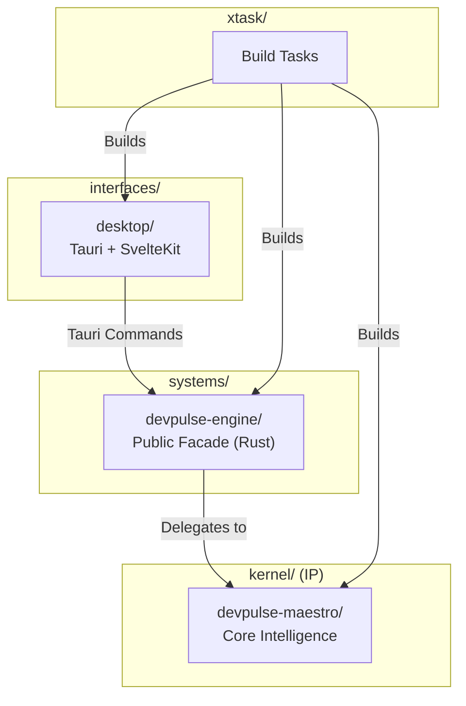
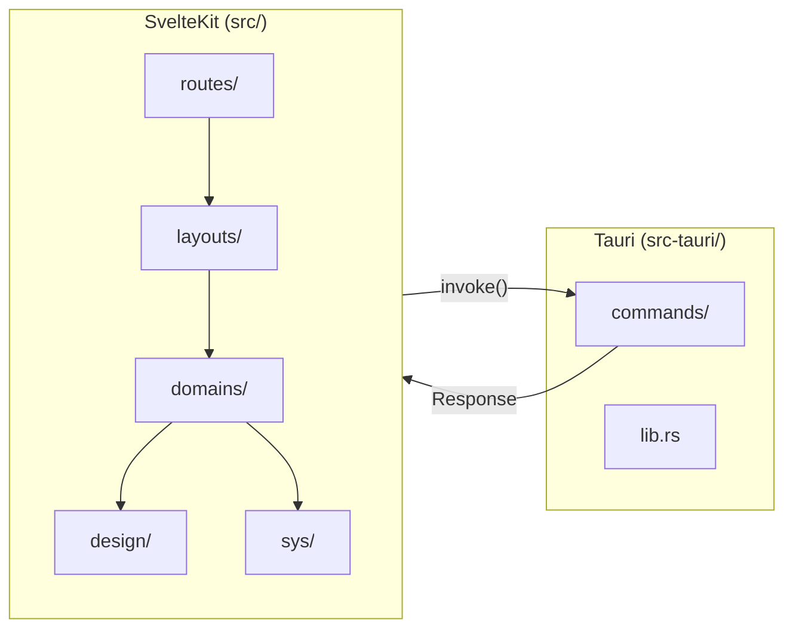
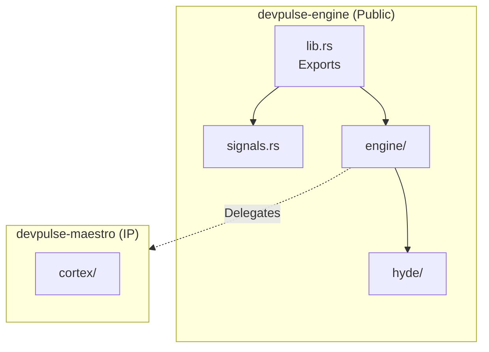
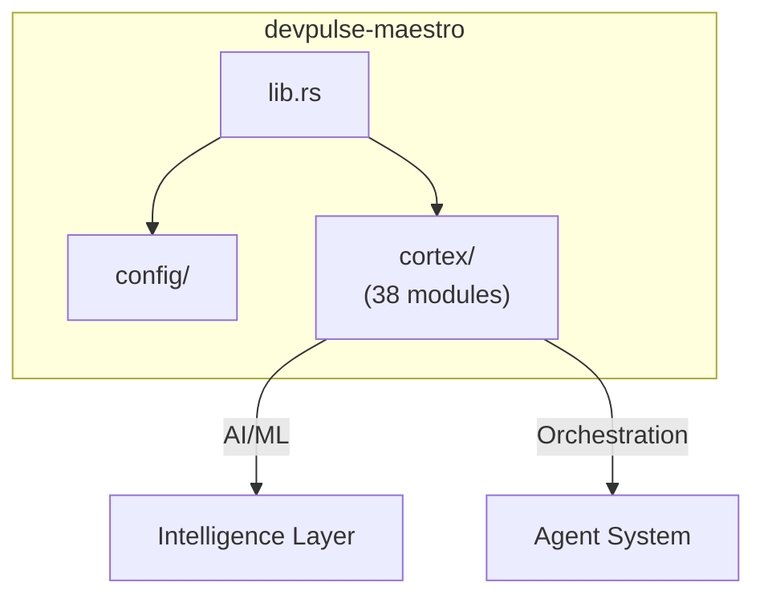
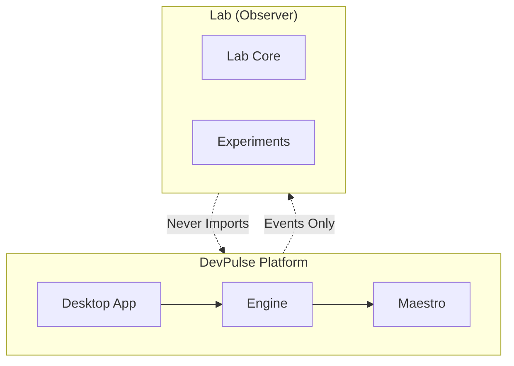

# DevPulse Platform - Development Notes

> **Last Updated:** 2026-01-18
> **Author:** AI Agent (Antigravity)

---

## Platform Architecture Overview



---

## Workspace Root Structure

```
platform_devpulse/
├── .agent/                    # AI agent workflows
├── alpha/                     # Alpha workspace (846 items)
├── archive/                   # Archived code
├── docs/                      # Documentation
│   └── platform/notes/        # Dev notes (this file)
├── interfaces/                # User interfaces
│   └── desktop/               # ★ PRIMARY: Tauri + SvelteKit
├── kernel/                    # ★ IP: Core intelligence
│   └── devpulse-maestro/      # Maestro orchestrator
├── systems/                   # ★ Public facade
│   └── devpulse-engine/       # Engine API
├── static/                    # Static assets
├── xtask/                     # Build tooling
├── Cargo.toml                 # Rust workspace manifest
├── Cargo.lock                 # Lock file
└── *.md                       # Sprint/planning docs
```

---

## 1. Desktop Application (`interfaces/desktop/`)

### Structure

```
interfaces/desktop/
├── .vscode/                   # VS Code config & snippets
│   ├── typescript.code-snippets
│   ├── css.code-snippets
│   └── svelte.code-snippets
├── scripts/                   # Dev automation
│   ├── dev/
│   │   └── inject-headers.ts  # File header automation
│   └── tsconfig.json
├── src/                       # ★ SvelteKit Frontend
│   ├── lib/
│   │   ├── cfg/              # Configuration
│   │   ├── design/           # COLD LIGHT Design System
│   │   │   ├── tokens/       # CSS tokens (SSOT)
│   │   │   ├── primitives/   # MeltUI components
│   │   │   ├── semantics/    # Styled tokens
│   │   │   ├── compositions/ # Combined primitives
│   │   │   ├── components/   # (Legacy)
│   │   │   ├── plugins/      # Extensible features
│   │   │   ├── STYLE_GUIDE.md
│   │   │   └── README.md
│   │   ├── domains/          # Feature domains
│   │   │   └── app/
│   │   │       ├── devmaestro/   # Project management
│   │   │       ├── overmind/     # AI orchestration
│   │   │       ├── thinkspace/   # Thinking environment
│   │   │       ├── wiredfront/   # Media hub
│   │   │       │   └── viziwizi/ # Visual editor
│   │   │       ├── home/         # Home dashboard
│   │   │       └── user/         # User domains
│   │   ├── layouts/          # Page layouts
│   │   │   ├── app/          # Main app layout
│   │   │   │   └── components/
│   │   │   └── chat/         # Chat layout
│   │   │       ├── overlays/
│   │   │       └── panels/
│   │   └── sys/              # System modules
│   │       ├── debug/        # Debug tools
│   │       │   └── vpb/      # Visual Page Builder ★
│   │       │       ├── components/
│   │       │       │   └── styles/
│   │       │       ├── dnd/
│   │       │       ├── scan/
│   │       │       └── state/
│   │       ├── runes/        # Svelte Runes state
│   │       └── app_state.svelte.ts
│   ├── routes/               # SvelteKit routes
│   ├── app.css               # Global styles
│   └── app.html              # HTML template
└── src-tauri/                # ★ Rust Backend
    ├── src/
    │   ├── commands/         # Tauri commands
    │   │   ├── chat/         # Chat operations
    │   │   │   ├── history.rs
    │   │   │   ├── interactions.rs
    │   │   │   └── mod.rs
    │   │   ├── devmaestro/   # DevMaestro ops
    │   │   │   └── mod.rs
    │   │   ├── sys/          # System ops
    │   │   │   ├── config.rs
    │   │   │   ├── guard.rs
    │   │   │   ├── logger.rs
    │   │   │   └── mod.rs
    │   │   ├── thinkmaestro/ # ThinkMaestro ops
    │   │   │   └── mod.rs
    │   │   ├── wiredfront/   # WiredFront ops
    │   │   │   └── mod.rs
    │   │   └── mod.rs
    │   ├── lib.rs            # Library entry
    │   └── main.rs           # App entry
    ├── Cargo.toml
    └── tauri.conf.json
```

### Desktop Architecture Diagram



---

## 2. Engine Facade (`systems/devpulse-engine/`)

> **Purpose:** Public API facade that delegates to Maestro (IP protection)

### Structure

```
systems/devpulse-engine/
├── Cargo.toml
├── README.md
├── _MAINTENANCE.md
├── _SYMMETRY_PROTOCOL.md      # IP boundary rules
└── src/
    ├── lib.rs                 # Public exports
    ├── signals.rs             # Signal handling
    ├── engine/                # Engine core
    │   └── (5 files)
    └── hyde/                  # Hyde module
        └── (1 file)
```

### Engine Diagram



---

## 3. Maestro Core (`kernel/devpulse-maestro/`)

> **Purpose:** Core intelligence - IP PROTECTED

### Structure

```
kernel/devpulse-maestro/
├── Cargo.toml
├── README.md
├── _MAINTENANCE.md
├── _SYMMETRY_PROTOCOL.md      # IP boundary rules
└── src/
    ├── lib.rs                 # Entry point
    ├── config/                # Configuration (2 files)
    └── cortex/                # ★ Core brain (38 files)
```

### Maestro Diagram



---

## 4. Build Tasks (`xtask/`)

> **Purpose:** Cargo xtask pattern for build automation

### Structure

```
xtask/
├── Cargo.toml
├── README.md
└── src/
    └── main.rs                # Build task entry
```

---

## Tech Stack Summary

### Frontend (Desktop)
| Technology | Version | Purpose |
|------------|---------|---------|
| **SvelteKit** | 5.x | Framework |
| **Svelte 5** | 5.x | UI with Runes |
| **MeltUI** | 2.x | Accessible primitives |
| **OKLCH** | CSS | Color system |
| **CSS Grid** | Native | Layouts |
| **svelte-sonner** | 1.x | Toast notifications |
| **TanStack** | - | Virtual lists, tables |

### Backend (Tauri)
| Technology | Version | Purpose |
|------------|---------|---------|
| **Tauri** | 2.x RC | Desktop runtime |
| **Rust** | 1.75+ | Backend logic |
| **SQLite** | - | Local database |

### Systems (Rust)
| Crate | Purpose |
|-------|---------|
| **devpulse-engine** | Public facade |
| **devpulse-maestro** | Core intelligence (IP) |

---

## Lab Observer Architecture

> **CRITICAL:** Lab is completely separate and subscribes as an observer.



**Lab Rules:**
1. Lab NEVER imports from Desktop/Engine/Maestro directly
2. Lab subscribes via event bus / message passing
3. Lab can be disabled without breaking platform
4. Lab has its own isolated dependency scope
5. Experimental features stay in Lab until proven

---

## Key Commands

```bash
# Desktop development
cd interfaces/desktop/src
pnpm dev                    # Start dev server
pnpm build                  # Production build
pnpm check                  # svelte-check

# Header automation
pnpm headers:check          # Check for missing headers
pnpm headers:inject         # Add headers to files

# Rust workspace
cargo build                 # Build all crates
cargo xtask                 # Run build tasks
```
