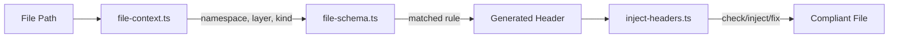
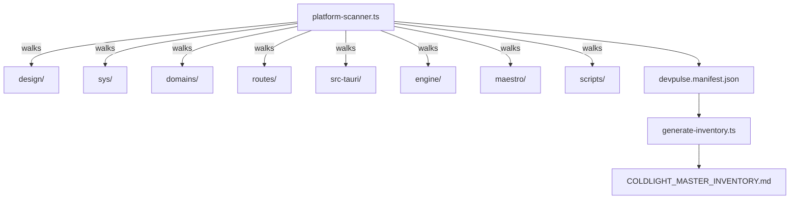

# ColdLight Architecture

## File Schema System

Every file in the DevPulse platform is governed by a master file schema (`file-schema.ts`). The schema declares:

- Required JSDoc/doc tags per file type
- Header content generation rules
- Namespace and layer classification

### How It Works

1. `file-context.ts` resolves any absolute path into a `FileContext` — namespace, layer, kind, language, contract info
2. `file-schema.ts` matches the `FileContext.localPath` against 45+ ordered rules
3. Each rule specifies required tags and a header generator function
4. `inject-headers.ts` uses the schema to check, inject, or patch headers

### Modes

| Mode | Purpose | Safe? |
|------|---------|-------|
| `check` | Report files needing attention (CI: exit 1) | Read-only |
| `inject` | Add headers to files with NO header | Write |
| `fix` | Patch missing tags into existing headers + inject missing | Write, preserves content |
| `validate` | Strict: exit 1 if ANY file has wrong/missing header | Read-only |

### Tag Patching

The `fix` mode is non-destructive. It inserts missing tags into existing headers WITHOUT replacing content:

- **JSDoc** (`/** ... */`): Missing tags inserted before closing `*/`
- **Svelte** (`<!-- ... -->`): Missing tags inserted before closing `-->`
- **Rust** (`//! ...`): Missing tags appended at end of `//!` block

## Platform Scanner

The platform scanner (`platform-scanner.ts`) walks the entire DevPulse filesystem and produces a structured manifest:

## Contract-Aware Parity

Each primitive declares an `ariaStateProvider` in its contract:

| Provider | Meaning | Parity Check |
|----------|---------|-------------|
| `"meltui"` | MeltUI handles ARIA | contract + adapter folder + .svelte |
| `"coldlight"` | ColdLight handles ARIA | contract + .svelte |
