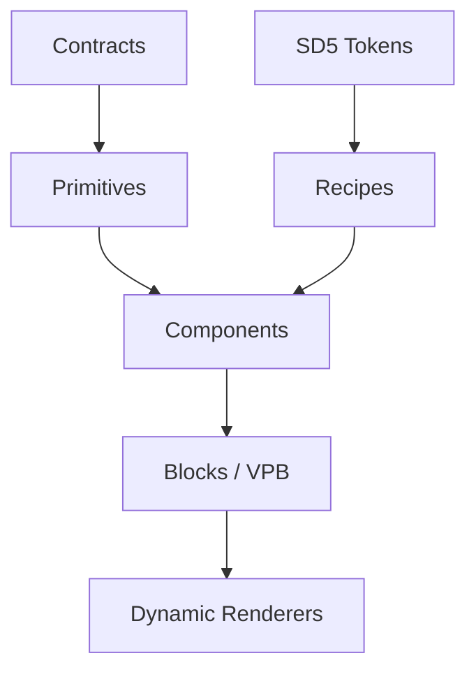
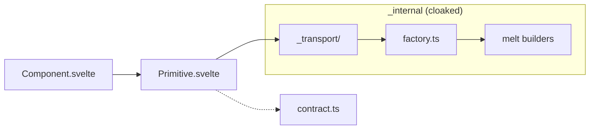

# ColdLight Design System

ColdLight (`@devpulse/coldlight`) is the design system powering all DevPulse user interfaces.

## Core Principles

- **Config-driven** — `coldlight.config.ts` declares everything; build tools read config
- **Schema-driven** — Zod validates all contracts, tokens, props at boundaries
- **Manifest-producing** — Scanner generates `coldlight.manifest.json` from taxonomy
- **ColdLight-owned by default** — MeltUI adapter used ONLY when justified
- **Style Dictionary v5** token pipeline (SD5 + DTCG 1.0)
- **Fully tested** — Vitest browser tests (Chromium) + Playwright E2E

## Architecture Layers



| Layer | Purpose | Location |
|-------|---------|----------|
| **Tokens** | Design tokens (global → semantic → component) | `tokens/` |
| **Primitives** | Unstyled, accessible components | `primitives/{kind}/` |
| **Recipes** | Styling patterns (class-based) | `recipes/` |
| **Components** | Styled: primitive + recipe + ARIA | `components/{kind}/` |
| **Blocks** | Page-level compositions (VPB) | `blocks/` |
| **Renderers** | Dynamic block rendering | `renderers/` |

## Adapter Layer

ColdLight uses an adapter pattern for complex widget interactions:



- **MeltUI adapter**: For complex widgets (accordion, dialog, tabs, etc.)
- **ColdLight adapter**: For widgets ColdLight owns entirely (dialog, tabs ColdLight variants)
- Consumers NEVER import from `melt` or `_internal/` directly

## Commands

```bash
pnpm platform:scan         # Scan all platform files, report status
pnpm coldlight:inventory   # Generate markdown inventory
pnpm headers:check         # Check file header compliance
pnpm headers:fix           # Patch missing tags into headers
pnpm docs:api              # Generate TypeDoc API reference
```
