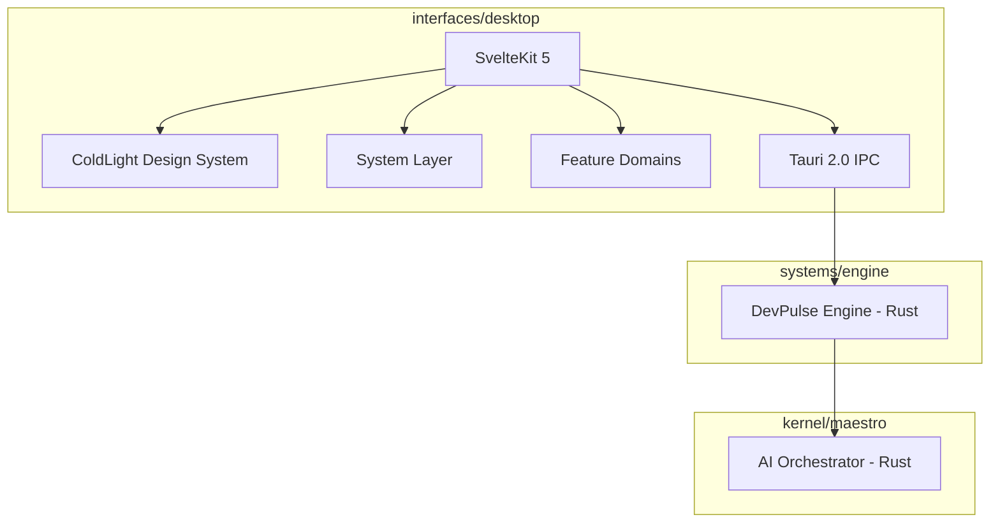

# DevPulse Platform Documentation

DevPulse is a local-first hybrid desktop application built on Tauri 2.0 + SvelteKit 5.

## Platform Architecture

## Namespaces

| Namespace | Scope | Language |
|-----------|-------|----------|
| `@devpulse/coldlight` | Design system | TypeScript / Svelte |
| `@devpulse/sys` | System layer | TypeScript |
| `@devpulse/domains/{name}` | Feature domains | TypeScript / Svelte |
| `@devpulse/routes` | SvelteKit routes | Svelte |
| `@devpulse/tauri` | Desktop commands | Rust |
| `@devpulse/engine` | Signal engine | Rust |
| `@devpulse/maestro` | AI orchestrator | Rust |
| `@devpulse/scripts` | Build automation | TypeScript |

## Quick Links

- [ColdLight Design System](/coldlight/overview) — tokens, primitives, recipes, components
- [API Reference](/api) — TypeDoc-generated API documentation
- [Platform Scanner](/platform/header-compliance) — header compliance and file coverage
- [Sprints](/sprints) — sprint planning and tracking
