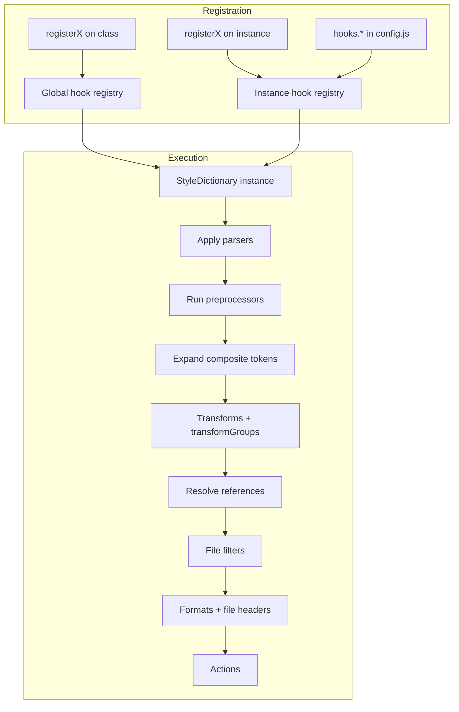

# Style Dictionary v5 — Complete Reference

> Comprehensive API, configuration, pipeline, and migration reference for SD5 (v5.3.3+).
> Node.js >= 22 required. ESM-only. Async API throughout.

---

## Executive Summary

Style Dictionary v5 is a largely "drop-in" upgrade focused on internal refactors and much faster handling of large token sets — especially for projects with many token references (aliases).

The v5 breaking changes are intentionally small, but they are real:
- **Node.js >= 22** required
- **Reference syntax customization removed** — fixed to DTCG spec (`{}` and `.`)
- **Strict references** — can only reference actual token nodes, not arbitrary leaf nodes or sub-properties

From an API perspective, v5 centers around `new StyleDictionary(config, options)` and async instance methods like `buildAllPlatforms()`, `buildPlatform()`, `formatAllPlatforms()`, and `getPlatformTokens()` — with predictable caching controls via `opts.cache`.

Customization happens through a coherent "hooks" + registration model: parsers, preprocessors, transforms, transformGroups, formats, filters, fileHeaders, and actions can be registered either globally (class-level `registerX`) or scoped to a single instance (instance-level).

---

## One-Page Cheat Sheet

### Command + Config + Output Mapping

| Goal | CLI (v5) | Key flags | Config knobs | Common transformGroup | Common format(s) | Notes |
|---|---|---|---|---|---|---|
| Build everything | `style-dictionary build` | `-c/--config`, `-s/--silent`, `-v/--verbose`, `-n/--no-warn` | `platforms` + `files` | depends on platform | depends on files | Build/clean/init/version are the core CLI commands |
| Build one platform | `style-dictionary build -p <platform>` | `-p/--platform` | `platforms.<platform>` | e.g. `css`, `scss`, `js`, `android`, `ios`, `ios-swift` | any | Mirrors `buildPlatform('name')` |
| Clean generated files | `style-dictionary clean` | same flags as build | `files[].destination` + actions undo | n/a | n/a | Clean runs action undo hooks as well |
| Bootstrap a repo | `style-dictionary init basic \| complete` | n/a | generated starter config | n/a | n/a | Produces a starter layout |
| Generate CSS variables | `style-dictionary build` | often `--verbose` | `format: "css/variables"` + `options.selector`, `options.outputReferences` | `css` | `css/variables` | Supports `selector` + `outputReferences` |
| Generate SCSS variables/maps | `style-dictionary build` | | `scss/variables`, `scss/map-flat`, `scss/map-deep` | `scss` | `scss/variables`, `scss/map-deep` | `scss/variables` supports `themeable: true` for `!default` |
| Generate JS modules | `style-dictionary build` | | `javascript/es6` or `javascript/esm` | `js` | `javascript/es6`, `javascript/esm`, `javascript/module-*` | Includes ES6 exports and object/module variants |
| Generate JSON outputs | `style-dictionary build` | | `json`, `json/nested`, `json/flat` | often `js` or none | `json`, `json/nested`, `json/flat` | Pairs well with stripMeta behavior |
| Generate Android XML | `style-dictionary build` | | `android/resources` + `file.filter` per type | `android` | `android/resources` (+ `android/colors`, etc.) | Docs recommend `android/resources` + filter over per-type legacy formats |
| Generate Android Compose | `style-dictionary build` | | `compose/object` + options (`packageName`/`className`/`imports`) | `android` or custom | `compose/object` | Compose format supports imports/package/object options |
| Generate iOS Swift | `style-dictionary build` | | `ios-swift/class.swift` or `ios-swift/enum.swift` + options | `ios-swift` | `ios-swift/class.swift`, `ios-swift/enum.swift`, `ios-swift/any.swift` | Supports access control/import/className and outputReferences |
| Add custom transforms/formats | n/a | n/a | `hooks.transforms`, `hooks.formats` or `registerTransform`, `registerFormat` | custom | custom | Registration global or per instance; order matters for transforms |
| Debug collisions & references | `style-dictionary build --verbose` | `--verbose`, `--no-warn`, `--silent` | `log.warnings`, `log.verbosity`, `log.errors.brokenReferences` | n/a | n/a | "verbose" expands reference/collision details |
| Fix `[object Object]` outputs | n/a | | enable `expand` or add value transform/custom format | n/a | n/a | Composite tokens need `expand` or custom formatting |

---

## API Surface and Module Entrypoints

### Package Shape

As of v5.3.3, Style Dictionary ships as an ES module package (`"type": "module"`) and requires **Node.js >= 22.0.0**.

Key exports:

| Entrypoint | Contents |
|---|---|
| `style-dictionary` | Main API (constructor + instance methods + static registration) |
| `style-dictionary/enums` | Enum-like JS objects (formats, transforms, transformGroups, log levels, etc.) |
| `style-dictionary/utils` | Helpers for formatting, reference resolution, DTCG conversion, token flattening/stripping |
| `style-dictionary/types` | TypeScript declaration entrypoint |

### Constructor

```js
import StyleDictionary from 'style-dictionary';

// From config object
const sd = new StyleDictionary({
  source: ['tokens/**/*.json'],
  platforms: { /* ... */ }
});

// From config file path
const sd = new StyleDictionary('sd.config.js');

// With options
const sd = new StyleDictionary(config, {
  verbosity: 'verbose',   // override log verbosity
  warnings: 'error',      // treat warnings as errors
  volume: memfsInstance,   // custom filesystem for isolation
});
```

Supports JSON, JSONC, JSON5, or JavaScript ESM config files. TypeScript config supported via Bun/Deno or Node >= 22.6.0 (`--experimental-strip-types`).

### Instance Methods

| Method | Returns | Purpose |
|---|---|---|
| `extend(config, options?)` | `Promise<SDInstance>` | Create derived instance with merged config |
| `getPlatformTokens(platform, opts?)` | `Promise<Dictionary>` | Get processed tokens for a platform |
| `getPlatformConfig(platform, opts?)` | `Promise<PlatformConfig>` | Get resolved platform config |
| `formatPlatform(platform, opts?)` | `Promise<Array<{ output; destination? }>>` | Run formats without writing files |
| `formatAllPlatforms(opts?)` | `Promise<Record<platform, outputs>>` | Format all platforms in-memory |
| `buildPlatform(platform, opts?)` | `Promise<SDInstance>` | Build + write files for one platform |
| `buildAllPlatforms(opts?)` | `Promise<SDInstance>` | Build + write all platforms |
| `cleanPlatform(platform, opts?)` | `Promise<SDInstance>` | Remove generated files for one platform |
| `cleanAllPlatforms(opts?)` | `Promise<SDInstance>` | Remove all generated files |

All methods accept `opts?: { cache?: boolean }` — controls whether to reuse already-processed tokens/config within a process. Disable caching if you mutate tokens between runs.

**Important**: `formatPlatform`/`formatAllPlatforms` can return non-string outputs if your format returns non-strings — but those cannot be used with `build*` because build writes to the filesystem.

**Deprecated**: `exportPlatform` and `getPlatform` — use `getPlatformTokens` and `getPlatformConfig` instead.

### Registration APIs (Plugin/Hook Surface)

Registration is supported globally (class-level, affects future instances) or per-instance (scoped):

```js
// Global registration (class method)
StyleDictionary.registerTransform({ /* ... */ });
StyleDictionary.registerFormat({ /* ... */ });

// Instance registration (scoped)
const sd = new StyleDictionary(config);
sd.registerTransform({ /* ... */ });  // only affects this instance
```

Class methods:

| Method | Registers |
|---|---|
| `registerParser` | File parser (string → object) |
| `registerPreprocessor` | Dictionary preprocessor |
| `registerTransform` | Token transform (name/value/attribute) |
| `registerTransformGroup` | Named set of transforms |
| `registerFormat` | Output format |
| `registerFilter` | Token filter |
| `registerFileHeader` | File header template |
| `registerAction` | Post-build action |

---

## Configuration Schema

### Top-Level Config Keys

```js
export default {
  source: string[],           // Globs for token files (deep-merged)
  include: string[],          // Baseline tokens (overridden by source)
  tokens: object,             // Inline token dictionary (alternative to files)
  platforms: Record<string, PlatformConfig>,
  parsers: string[],          // Parser names to apply
  preprocessors: string[],    // Preprocessor names to apply
  hooks: Hooks,               // Inline hook definitions (alternative to registerX)
  expand: ExpandConfig,       // Composite token expansion (default: off)
  usesDtcg: boolean,          // Auto-detected in many cases
  log: LogConfig,             // Logging behavior
};
```

### Platform Config Structure

```js
platforms: {
  css: {
    transformGroup?: string,           // Named transform group
    transforms?: string[],             // Individual transforms (overrides group)
    buildPath?: string,                // Must end with /
    prefix?: string,                   // Token name prefix
    files: FileConfig[],               // Output file definitions
    actions?: string[],                // Post-build actions
    preprocessors?: string[],          // Platform-specific preprocessors
    expand?: ExpandConfig,             // Platform-specific expansion
    options?: {                        // Merged into file options
      outputReferences?: boolean,
      showFileHeader?: boolean,
      fileHeader?: string,
    },
  }
}
```

### File Config

```js
files: [{
  destination: string,        // Output file path (relative to buildPath)
  format: string,             // Format name
  filter?: string | function | object,  // Token filter
  options?: {
    outputReferences?: boolean | function,
    outputReferencesFilter?: function,
    showFileHeader?: boolean,
    fileHeader?: string,
    selector?: string,        // CSS selector (for css/variables)
  },
}]
```

### Composite Token Expansion (`expand`)

Critical for DTCG-era object-valued tokens. Without it, string-only formats show `[object Object]`.

```js
// Simple: expand all composite tokens
expand: true

// Function: conditional expansion
expand: (token, config, platformConfig) => boolean

// Object: granular control
expand: {
  include?: string[] | function,   // Types or matcher to expand
  exclude?: string[] | function,   // Types or matcher to skip
  typesMap?: object,               // Map sub-properties to DTCG types
}
```

**Timing**: Global expansion runs at instantiation (after preprocessors). Platform expansion runs per platform execution.

`typesMap` maps composite sub-properties to DTCG type categories:
```js
typesMap: {
  border: { width: 'dimension', style: 'strokeStyle', color: 'color' },
  shadow: { offsetX: 'dimension', offsetY: 'dimension', blur: 'dimension', spread: 'dimension', color: 'color' },
}
```

### Logging Configuration

```js
log: {
  warnings: 'warn' | 'error' | 'disabled',      // Default: 'warn'
  verbosity: 'default' | 'silent' | 'verbose',   // Default: 'default'
  errors: {
    brokenReferences: 'throw' | 'console',        // Default: 'throw'
  },
}
```

CLI equivalents: `--verbose`, `--silent`, `--no-warn`.

---

## Tokens, Transforms, Formats, References, and Hooks

### Token Object Model — DTCG Alignment

Two supported syntaxes (do NOT mix within the same instance):

| Property | Legacy SD | DTCG |
|---|---|---|
| Value | `value` | `$value` |
| Type | `type` | `$type` |
| Description | `comment` | `$description` |
| Extensions | — | `$extensions` |

### v5 Reference Strictness (Breaking)

- References can **only target design token nodes** (nodes with a value)
- Referencing groups, metadata, or sub-properties is **no longer allowed**
- Reference syntax customization is **removed** — fixed to `{path.to.token}` (DTCG spec)

### Built-in Transforms — Matching Rules

v5 determines token "type" using `token.type` or `$type` (DTCG) and matches transforms accordingly. The v3-era CTI (category/type/item) structure is no longer the primary matching mechanism.

**Transform categories:**

| Category | Examples | Matching |
|---|---|---|
| `attribute/*` | `attribute/cti` | All tokens |
| `name/*` | `name/camel`, `name/kebab`, `name/snake`, `name/pascal`, `name/constant` | All tokens |
| `color/*` | `color/css`, `color/hex`, `color/rgb`, `color/hsl`, `color/hsl-4`, `color/hex8android`, `color/UIColor`, `color/UIColorSwift`, `color/composeColor`, `color/oklch`, `color/oklab`, `color/p3` | `$type === 'color'` |
| `size/*` | `size/px`, `size/rem`, `size/pxToRem`, `size/remToPx`, `size/remToPt`, `size/sp`, `size/dp`, `size/object` | `$type === 'dimension'` |
| `css/shorthand/*` | `shadow/css/shorthand`, `typography/css/shorthand`, `border/css/shorthand`, `transition/css/shorthand`, `fontFamily/css/shorthand`, `cubicBezier/css/shorthand`, `strokeStyle/css/shorthand` | Composite types (transitive) |
| `content/*` | `content/icon`, `content/quote`, `content/objC/literal` | `$type === 'content'` |
| `time/*` | `time/seconds` | `$type === 'duration'` |
| `html/*` | `html/icon` | `$type === 'html'` |
| `asset/*` | `asset/url/base64`, `asset/base64`, `asset/path`, `asset/objC/literal` | `$type === 'asset'` |

### Built-in Formats

| Target | Format name | Key options |
|---|---|---|
| **CSS** | `css/variables` | `selector`, `outputReferences`, `showFileHeader` |
| **SCSS** | `scss/variables` | `themeable` (adds `!default`), `outputReferences` |
| **SCSS** | `scss/map-flat`, `scss/map-deep` | `mapName` |
| **Less** | `less/variables` | |
| **JS** | `javascript/es6` | Named ES6 exports |
| **JS** | `javascript/esm` | ESM default export |
| **JS** | `javascript/module`, `javascript/module-flat` | CommonJS |
| **JS** | `javascript/object`, `javascript/umd` | Object/UMD wrappers |
| **TS** | `typescript/es6-declarations`, `typescript/module-declarations` | Type declarations |
| **JSON** | `json`, `json/nested`, `json/flat` | |
| **Android** | `android/resources` | Use with `filter` per type (recommended) |
| **Android** | `android/colors`, `android/dimens`, `android/fontDimens`, `android/strings` | Legacy per-type |
| **Compose** | `compose/object` | `packageName`, `className`, `imports` |
| **iOS** | `ios-swift/class.swift`, `ios-swift/enum.swift`, `ios-swift/any.swift` | `className`, `accessControl`, `import`, `outputReferences` |

### Reference Utilities (`style-dictionary/utils`)

```js
import { usesReferences, resolveReferences, getReferences } from 'style-dictionary/utils';

usesReferences(valueString)                    // → boolean
resolveReferences(valueString, tokens, opts)   // → resolvedString
getReferences(valueString, tokens, opts)       // → referenceList
```

Accept `usesDtcg` option for `$value` syntax. Can operate on a `Map()` for better performance.

### `outputReferences` and Filtering Interaction

If a token in the output references a token that was **filtered out**, Style Dictionary warns. Use `outputReferencesFilter` to conditionally fall back to resolved values when a reference would be broken:

```js
files: [{
  destination: 'tokens.css',
  format: 'css/variables',
  filter: (token) => token.attributes.category === 'color',
  options: {
    outputReferences: true,
    // Fall back to resolved value if referenced token was filtered out
    outputReferencesFilter: (token) => token.attributes.category === 'color',
  },
}]
```

### Hook System

Hooks can be registered via `registerX` or defined inline under `hooks.*` in JS config.

#### Parsers
Match files via regex, parse string contents → object. Can be async.

```js
hooks: {
  parsers: {
    'yaml-parser': {
      pattern: /\.ya?ml$/,
      parser: ({ contents, filePath }) => yaml.parse(contents),
    }
  }
},
parsers: ['yaml-parser'],  // Must reference by name
```

#### Preprocessors
Operate on the entire merged dictionary (global or per platform). **Use as last resort** — parsers/transforms are safer for granular behavior.

Two default preprocessors always run after custom ones:
1. `typeDtcgDelegate` — DTCG type inheritance ($type pushed down to tokens)
2. Internal expansion preprocessor (if `expand` is enabled)

```js
hooks: {
  preprocessors: {
    'strip-meta': {
      preprocessor: (dictionary) => {
        // Modify and return dictionary
        return dictionary;
      }
    }
  }
},
preprocessors: ['strip-meta'],
```

#### Filters
Run before formatting for a file. Can be named (registered), inline function, or lodash-style object matching:

```js
// Named filter
filter: 'colorTokensOnly'

// Inline function
filter: (token) => token.$type === 'color'

// Object matching (lodash-style)
filter: { type: 'color' }
```

#### File Headers
Registered or inline, applied per file or per platform via `options.fileHeader`:

```js
hooks: {
  fileHeaders: {
    'custom-header': () => [
      'Auto-generated by ColdLight',
      `Generated: ${new Date().toISOString()}`,
    ]
  }
}
```

#### Actions
Run after files are built. Built-in examples: `copy_assets`, `android/copyImages`.

```js
hooks: {
  actions: {
    'log-completion': {
      do: (dictionary, config) => console.log(`Built ${config.buildPath}`),
      undo: (dictionary, config) => console.log(`Cleaned ${config.buildPath}`),
    }
  }
}
```

### Format Helpers

For writing custom formats:

```js
import { fileHeader, formattedVariables, createPropertyFormatter, sortByName, sortByReference } from 'style-dictionary/utils';
```

| Helper | Purpose |
|---|---|
| `fileHeader({ file })` | Generate file header comment |
| `formattedVariables({ format, dictionary, outputReferences, sorting })` | Generate formatted token output |
| `createPropertyFormatter({ format, dictionary, outputReferences })` | Create per-token formatter |
| `sortByName` | Sort tokens alphabetically |
| `sortByReference` | Sort so referenced tokens come first |

### DTCG Utilities

```js
import { convertToDTCG, convertJSONToDTCG, convertZIPToDTCG } from 'style-dictionary/utils';
```

**Warning**: Do NOT run `convertToDTCG` with `applyTypesToGroup: true` inside a preprocessor hook — Style Dictionary relies on `typeDtcgDelegate` running at a specific stage.

---

## Build Pipeline and CLI

### Pipeline Stages (12 Steps)

```
1. Parse config
2. Resolve globs (include + source)
3. Parse token files via parsers
4. Deep merge into dictionary
5. Run preprocessors (global)
6. Expand composite tokens (if enabled)
7. [Per platform]:
   a. Run preprocessors (platform-specific)
   b. Apply transforms (sequential)
   c. Resolve references / aliases
   d. Transitive transforms loop (if needed)
   e. Per-file filters
   f. Formats + file headers → write outputs
   g. Actions (+ undo hooks on clean)
```



```mermaid
flowchart LR
  A[Config] --> B[Resolve globs: include + source]
  B --> C[Parse token files via parsers]
  C --> D[Deep merge into dictionary]
  D --> E[Run preprocessors]
  E --> F[Optional expand composite tokens]
  F --> G[Apply transforms - sequential]
  G --> H[Resolve references / aliases]
  H --> I[Transitive transforms loop if needed]
  I --> J[Per-file filters]
  J --> K[Formats + file headers]
  K --> L[Write outputs]
  L --> M[Actions + undo hooks on clean]
```

### Hook Registration → Application Flow



### CLI Commands

| Command | Purpose |
|---|---|
| `style-dictionary build [options]` | Build all platforms |
| `style-dictionary clean [options]` | Remove generated files |
| `style-dictionary init <basic\|complete>` | Scaffold starter project |
| `style-dictionary --version` | Print version |

| Flag | Short | Purpose |
|---|---|---|
| `--config <path>` | `-c` | Config file (default: `./config.json`) |
| `--platform <name>` | `-p` | Target single platform |
| `--silent` | `-s` | Suppress output |
| `--verbose` | `-v` | Expanded diagnostics |
| `--no-warn` | `-n` | Suppress warnings |

---

## Minimal Reproducible Example (v5)

### Project Structure

```
my-style-dictionary/
  package.json
  tokens/
    core.tokens.json
  sd.config.js
  build.mjs
  build/         (generated)
```

### Example Tokens (DTCG)

```json
{
  "color": {
    "$type": "color",
    "brand": {
      "primary": { "$value": "#3366ff" }
    }
  },
  "dimension": {
    "$type": "dimension",
    "space": {
      "2": { "$value": "8px" }
    }
  },
  "semantic": {
    "bg": {
      "primary": { "$type": "color", "$value": "{color.brand.primary}" }
    }
  }
}
```

### sd.config.js (ESM Config with Inline Hooks)

```js
import { formats, transformGroups, transformTypes } from 'style-dictionary/enums';

export default {
  source: ['tokens/**/*.tokens.json'],

  hooks: {
    transforms: {
      'my/size/ensurePx': {
        type: transformTypes.value,
        filter: (token) => token.$type === 'dimension' || token.type === 'dimension',
        transform: (token) => {
          const v = token.value ?? token.$value;
          if (typeof v === 'number') return `${v}px`;
          return v;
        },
      },
    },

    formats: {
      'my/json/token-list': ({ dictionary }) =>
        JSON.stringify(
          dictionary.allTokens.map((t) => ({
            name: t.name,
            value: t.value,
            type: t.type,
          })),
          null,
          2,
        ),
    },
  },

  platforms: {
    css: {
      transformGroup: transformGroups.css,
      buildPath: 'build/css/',
      files: [
        {
          destination: 'variables.css',
          format: formats.cssVariables,
          options: {
            outputReferences: true,
            selector: ':root',
          },
        },
      ],
    },

    scss: {
      transformGroup: transformGroups.scss,
      buildPath: 'build/scss/',
      files: [
        { destination: '_variables.scss', format: formats.scssVariables },
      ],
    },

    js: {
      transformGroup: transformGroups.js,
      buildPath: 'build/js/',
      files: [
        { destination: 'tokens.js', format: 'javascript/es6' },
        { destination: 'tokens.json', format: 'my/json/token-list' },
      ],
    },

    android: {
      transformGroup: transformGroups.android,
      buildPath: 'build/android/',
      files: [
        {
          destination: 'colors.xml',
          format: formats.androidResources,
          filter: { type: 'color' },
        },
        {
          destination: 'dimens.xml',
          format: formats.androidResources,
          filter: { type: 'dimension' },
        },
      ],
    },

    ios: {
      transformGroup: transformGroups['ios-swift'],
      buildPath: 'build/ios/',
      files: [
        {
          destination: 'Tokens.swift',
          format: 'ios-swift/class.swift',
          options: {
            className: 'Tokens',
            outputReferences: true,
          },
        },
      ],
    },
  },
};
```

### build.mjs (Node Usage)

```js
import StyleDictionary from 'style-dictionary';

const sd = new StyleDictionary('sd.config.js');
await sd.buildAllPlatforms();
```

---

## Migration Checklist

### v4 → v5

| Task | Why it matters | How to verify |
|---|---|---|
| Upgrade Node runtime to >= 22 | v5 requires Node >= 22; performance relies on modern built-ins | CI/local `node --version`; set `engines` in package.json |
| Remove reference syntax customization | v5 removes customizing `{ref.foo}` syntax; fixed to `{token.path}` | Search config for custom ref syntax; run build |
| Fix illegal references to non-token nodes | v5 only allows references to design token nodes (value-level) | Run build; fix reference errors; update tokens |
| Validate tokens with "extra leaf nodes" | v5 filters out non-token leaf nodes from nested outputs | Compare generated JSON before/after |
| Re-test `outputReferences` with filters | Warnings if references point to filtered-out tokens | Use `--verbose`; adopt `outputReferencesFilter` if needed |
| Re-check composite token outputs | Object-valued tokens may need `expand` or custom formatting | Confirm no `[object Object]` in CSS/SCSS; enable `expand` |

### v3 → v4 (If Skipping Versions)

v4 introduced substantial breaking changes with codemods to assist:
- Hook APIs moved under `hooks.*`
- Naming changes: `matcher` → `filter` for transforms
- Redesigned logging configuration
- Registration method renames

---

## Troubleshooting FAQ

### `StyleDictionary.create is not a function` in v5
v5 uses `new StyleDictionary(config)` as the constructor. `create()` was removed.

### References that used to work now break in v5
Most commonly: referencing something other than a token node (group, metadata, sub-property). v5 only allows references to tokens (nodes with values).

### Warnings about "filtered out token references" with `outputReferences: true`
A token references another token that your file filter excludes → broken reference in output. Use `outputReferencesFilter` to decide when to keep refs vs output resolved values.

### CSS/SCSS outputs show `[object Object]`
Composite (object-valued) tokens. Enable `expand` or implement a custom value transform/format.

### DTCG `$type` values behaving unexpectedly
Style Dictionary runs `typeDtcgDelegate` to push group-level `$type` down to token level. Don't fight that in preprocessors. Don't use `convertToDTCG` with `applyTypesToGroup: true` inside a preprocessor.

---

## Performance Tips

| Tip | Why |
|---|---|
| Use `buildPlatform('css')` during iteration | Faster than building all platforms |
| Use logging intentionally | `--verbose` for debugging; `default`/`silent` in CI |
| Treat preprocessors as last resort | Parsers/transforms are more granular and safer |
| Use `expand` strategically | Prefer platform-level when you need `filePath`/`path` for conditional logic |
| Use `opts.cache` controls | Disable if mutating tokens/configs between runs |
| Use `volume` option for tests | `memfs` for containerized/in-memory output |

---

## Community Plugins and Ecosystem

| Package | Purpose |
|---|---|
| **Tokens Studio `sd-transforms`** | Transforms/preprocessors for Tokens Studio exports; includes theming/multi-dimensional concepts |
| **`style-dictionary-utils`** | Community filters/transforms/formats for W3C design token workflows |
| **Browser playground/forks** | Browser-oriented builds and playground tooling |

---

## Primary Sources

- Official v5 API reference (constructor, instance methods, registration methods)
- Official configuration reference (schema, files, platform options, expand)
- Official hooks docs: parsers, preprocessors, filters, file headers, actions
- Built-in formats list (CSS/SCSS/JS/JSON/Android/iOS/Compose) and option docs
- Built-in transforms list + matching rules (token.type / $type)
- v5 migration guidelines (breaking changes: strict references, fixed syntax, Node >= 22)
- Architecture docs (pipeline stages + lifecycle diagram)
- DTCG specification (type rules, format constraints)

---

> **See also:**
> - [00-overview](./00-overview.md) — Config schema, class API, registration
> - [01-dtcg-tokens](./01-dtcg-tokens.md) — DTCG format, composites, ColdLight 4-layer arch
> - [02-transforms](./02-transforms.md) — All 50+ built-in transforms
> - [04-formats](./04-formats.md) — Built-in formats, custom format API
> - [05-hooks-lifecycle](./05-hooks-lifecycle.md) — 12-step lifecycle
> - [07-advanced-patterns](./07-advanced-patterns.md) — Theming, multi-file output, extend()
> - [08-migration-v3-to-v5](./08-migration-v3-to-v5.md) — 18 breaking changes
> - [Tailwind v4 integration](./tailwind-presets/) — SD5 → TW4 pipeline
