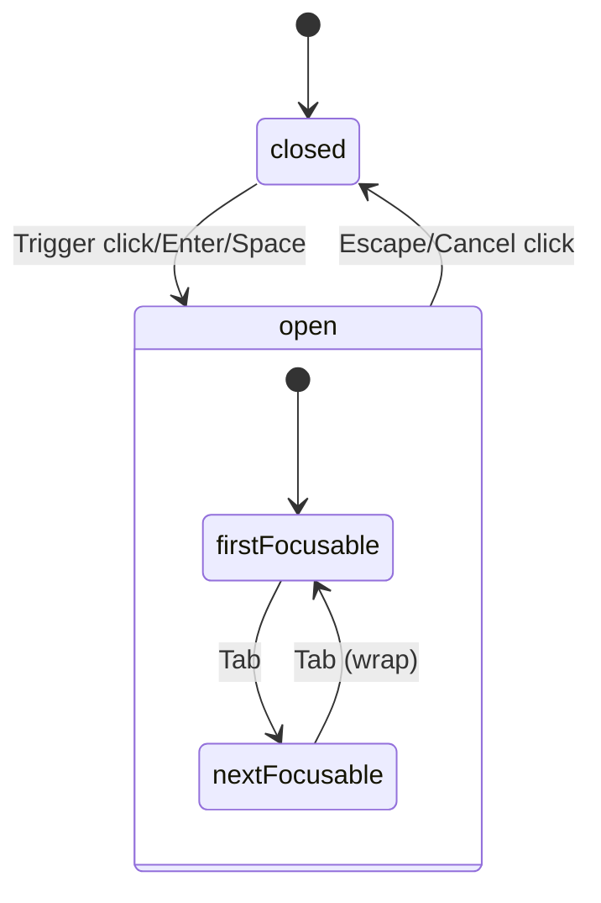

# AlertDialog Primitive - Accessibility Contract

> ARIA-compliant alert dialog for ColdLight design system.
> Based on [WAI-ARIA Alert Dialog Pattern](https://www.w3.org/WAI/ARIA/apg/patterns/alertdialog/).

## Key Differences from Dialog

AlertDialog is for **destructive/confirmation actions** that require explicit user decision.

| Aspect | Dialog | AlertDialog |
|--------|--------|-------------|
| **ARIA Role** | `role="dialog"` | `role="alertdialog"` |
| **Click Outside** | Closes by default | Does NOT close (default) |
| **Action Buttons** | `Close` (auto-closes) | `Action` (no auto-close) + `Cancel` (auto-closes) |
| **Use Case** | General modals | Destructive confirmations |

## ARIA Behavior

| Attribute | Element | Value | Source |
|-----------|---------|-------|--------|
| `role` | Content | `alertdialog` | Bits UI (automatic) |
| `aria-modal` | Content | `true` | Bits UI (automatic) |
| `aria-labelledby` | Content | Title ID | Bits UI (automatic) |
| `aria-describedby` | Content | Description ID | Bits UI (automatic) |
| `aria-haspopup` | Trigger | `dialog` | Bits UI (automatic) |
| `aria-expanded` | Trigger | `true/false` | Bits UI (automatic) |

## Keyboard Interaction

| Key | Action |
|-----|--------|
| `Enter` / `Space` | Opens alert dialog (on Trigger) |
| `Escape` | Closes alert dialog (unless disabled) |
| `Tab` | Cycles through focusable elements (trapped) |
| `Shift+Tab` | Cycles backwards through focusable elements |
| `Enter` / `Space` on Cancel | Closes alert dialog |
| `Enter` / `Space` on Action | Triggers action but does NOT close |

## Focus Management



1. **On open:** Focus moves to first focusable element in Content
   - Consider setting initial focus to Cancel button for safety (safe default)
2. **While open:** Focus is trapped within Content (Tab cycles)
3. **On close:** Focus returns to Trigger element

## Interact Outside Behavior

**DEFAULT: Clicking outside does NOT close the alert dialog**

This is intentional for confirmation dialogs - users must make an explicit choice:
- Click **Action** to confirm (performs action, dialog stays open until consumer closes)
- Click **Cancel** to abort (auto-closes dialog)
- Press **Escape** to abort (closes dialog, same as Cancel)

Can be overridden with `interactOutsideBehavior="close"` if needed.

## Data Attributes

| Attribute | Values | Purpose |
|-----------|--------|---------|
| `data-primitive` | `"alert-dialog"` | CSS primitive targeting |
| `data-slot` | `"root"` `"trigger"` `"portal"` `"overlay"` `"content"` `"title"` `"description"` `"action"` `"cancel"` | CSS slot targeting |
| `data-state` | `"open"` `"closed"` | CSS state targeting |
| `data-id` | User-defined | Testing/tooling |

## CSS Targeting

```css
/* Target alert dialog overlay */
[data-primitive="alert-dialog"][data-slot="overlay"][data-state="open"] {
  opacity: 1;
}

/* Target alert dialog content */
[data-primitive="alert-dialog"][data-slot="content"] {
  /* styles */
}

/* Target destructive action button */
[data-primitive="alert-dialog"][data-slot="action"] {
  /* destructive styling - red, bold, etc. */
}

/* Target cancel button */
[data-primitive="alert-dialog"][data-slot="cancel"] {
  /* subtle/secondary styling */
}
```

## Screen Reader Announcements

- Announces alert dialog title when opened (with "alertdialog" role context)
- Screen readers may announce this differently than regular dialog due to the `alertdialog` role
- Description read after title if present
- Background content hidden from screen readers via `aria-hidden`

## Testing Requirements

- [ ] Verify `role="alertdialog"` (NOT `role="dialog"`)
- [ ] Verify `aria-modal="true"`
- [ ] Verify `aria-labelledby` links to Title
- [ ] Verify `aria-describedby` links to Description
- [ ] Verify clicking outside does NOT close by default
- [ ] Verify Action button does NOT auto-close
- [ ] Verify Cancel button auto-closes
- [ ] Verify focus trapped within Content
- [ ] Verify focus returns to Trigger on close
- [ ] Verify all data attributes present on all slots

## VPB Use Cases

- **Delete confirmations:** "Delete this item?"
- **Discard changes:** "Discard unsaved changes?"
- **Destructive action warnings:** "This cannot be undone"
- **Critical confirmations:** "Are you absolutely sure?"

## Example Usage

```svelte
<AlertDialog.Root bind:open>
  <AlertDialog.Trigger>Delete Item</AlertDialog.Trigger>
  <AlertDialog.Portal>
    <AlertDialog.Overlay />
    <AlertDialog.Content>
      <AlertDialog.Title>Are you absolutely sure?</AlertDialog.Title>
      <AlertDialog.Description>
        This action cannot be undone. This will permanently delete your item.
      </AlertDialog.Description>
      <AlertDialog.Cancel>Cancel</AlertDialog.Cancel>
      <AlertDialog.Action onclick={() => { deleteItem(); open = false; }}>
        Delete
      </AlertDialog.Action>
    </AlertDialog.Content>
  </AlertDialog.Portal>
</AlertDialog.Root>
```
