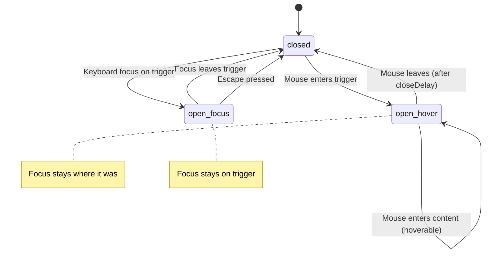

# Tooltip Primitive — Accessibility Contract

> Hover-triggered floating content for supplementary information.
> Based on [WAI-ARIA Tooltip Pattern](https://www.w3.org/WAI/ARIA/apg/patterns/tooltip/).

## Key Differences from Popover

- **Role**: Uses `role="tooltip"` (not dialog)
- **Triggered by**: Hover/focus (not click)
- **No close button**: Disappears automatically on mouse leave/blur
- **Purely informational**: Should not contain interactive elements
- **No focus trap**: Tooltip content is not focusable

## ARIA Behavior

| Attribute | Element | Value | Source |
|-----------|---------|-------|--------|
| `role` | Content | `"tooltip"` | ColdLight |
| `aria-describedby` | Trigger | Content ID (when open) | Bits UI |
| `tabindex` | Trigger | `"0"` | Bits UI |

**Note:** Tooltip does NOT have `aria-modal` or `aria-haspopup` — it's purely descriptive.

## Keyboard Interaction

| Key | Action |
|-----|--------|
| `Tab` | Focus trigger (shows tooltip) |
| `Shift+Tab` | Focus previous (hides tooltip) |
| `Escape` | Hides tooltip |

**Note:** Unlike Popover, no Enter/Space to open — focus alone triggers the tooltip.

## Focus Management

### Focus Behavior

| Event | Tooltip | Focus |
|-------|---------|-------|
| **Mouse hover** | Opens | Unchanged |
| **Keyboard focus** | Opens | On trigger |
| **Mouse leave** | Closes after delay | Unchanged |
| **Tab away** | Closes | Moves to next element |
| **Escape** | Closes | Stays on trigger |

## Data Attributes

| Attribute | Values | Purpose |
|-----------|--------|---------|
| `data-primitive` | `"tooltip"` | CSS primitive targeting |
| `data-slot` | `"root"` `"provider"` `"trigger"` `"portal"` `"content"` `"arrow"` | CSS slot targeting |
| `data-state` | `"open"` `"closed"` | CSS state targeting |
| `data-side` | `"top"` `"right"` `"bottom"` `"left"` | Position side (from Bits UI) |
| `data-align` | `"start"` `"center"` `"end"` | Position alignment (from Bits UI) |
| `data-id` | User-defined | Testing/tooling |

## Positioning Props

| Prop | Type | Default | Description |
|------|------|---------|-------------|
| `side` | `"top"` \| `"right"` \| `"bottom"` \| `"left"` | `"top"` | Preferred side |
| `sideOffset` | `number` | `4` | Distance from anchor |
| `align` | `"start"` \| `"center"` \| `"end"` | `"center"` | Alignment on side |
| `alignOffset` | `number` | `0` | Offset from alignment |
| `avoidCollisions` | `boolean` | `true` | Flip to avoid edges |
| `collisionPadding` | `number` | `8` | Viewport padding |

## Timing Props

| Prop | Type | Default | Description |
|------|------|---------|-------------|
| `openDelay` | `number` | `700` | Delay before showing (ms) |
| `closeDelay` | `number` | `300` | Delay before hiding (ms) |

## Provider Props (Global Defaults)

| Prop | Type | Default | Description |
|------|------|---------|-------------|
| `delayDuration` | `number` | `700` | Default open delay for all child tooltips |
| `closeDelay` | `number` | `300` | Default close delay |
| `skipDelayDuration` | `number` | - | Skip delay when moving between tooltips |
| `disableHoverableContent` | `boolean` | `false` | Prevent hovering over content |

## Screen Reader Announcements

1. When trigger is focused: Element label + description from tooltip
2. `aria-describedby` links trigger to tooltip content
3. Tooltip content read as description, not as focused element

## Content Guidelines

Tooltips should contain:
- Short, supplementary text
- Keyboard shortcuts
- Brief explanations

Tooltips should NOT contain:
- Interactive elements (buttons, links)
- Critical information required to complete a task
- Long-form content
- Images or complex media

## Testing Requirements

### ARIA
- [ ] Content has `role="tooltip"`
- [ ] Trigger has `aria-describedby` when open
- [ ] Trigger has `tabindex="0"` for keyboard access
- [ ] Content does NOT have `aria-modal`

### Hover/Focus
- [ ] Opens on mouse hover
- [ ] Opens on keyboard focus
- [ ] Closes on mouse leave (after delay)
- [ ] Closes on blur
- [ ] Closes on Escape

### Timing
- [ ] Respects openDelay
- [ ] Respects closeDelay
- [ ] Provider sets default delays for children

### Positioning
- [ ] Defaults to `side="top"`
- [ ] Content positions on correct side
- [ ] Content respects sideOffset
- [ ] Content flips when colliding with viewport

### Data Attributes
- [ ] All slots have `data-primitive="tooltip"`
- [ ] All slots have correct `data-slot`
- [ ] `data-state` changes on open/close
- [ ] `data-side` and `data-align` present on content
