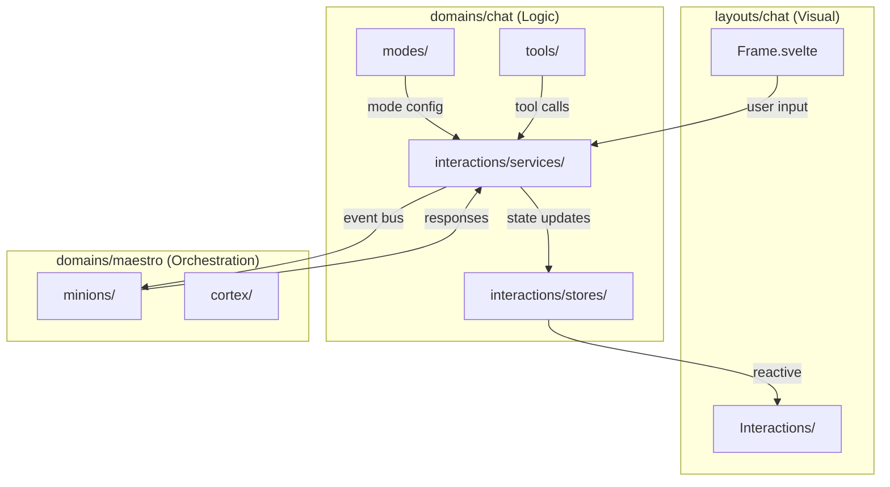

# domains/chat

> **Status:** `SCAFFOLD`
> **Version:** `0.1.0`
> **Last Updated:** `2026-01-22`
> **Layer:** `domains`
> **Kind:** `system`

---

## Overview

> **Philosophy**: "The business logic behind the conversation."

The **Chat Domain** handles all chat business logic, state management, and service integration. This domain is consumed by `layouts/chat` which provides the visual overlay. The domain itself is invisible — it orchestrates, validates, and persists.

```
┌──────────────────────────────────────────────────────────────────────────────┐
│  DOMAIN: CHAT (Business Logic Layer)                                         │
├──────────────────────────────────────────────────────────────────────────────┤
│                                                                              │
│  ┌─────────────────┐    ┌─────────────────┐    ┌─────────────────┐          │
│  │   INTERACTIONS  │    │     MODES       │    │     TOOLS       │          │
│  │   ────────────  │    │   ──────────    │    │   ────────      │          │
│  │  • Components   │    │  • DEVELOPER    │    │  • Code exec    │          │
│  │  • Pages        │    │  • PLANNING     │    │  • File ops     │          │
│  │  • Services     │    │  • IMAGE        │    │  • Search       │          │
│  │  • Stores       │    │  • GENERAL      │    │  • Transforms   │          │
│  └────────┬────────┘    └────────┬────────┘    └────────┬────────┘          │
│           │                      │                      │                    │
│           └──────────────────────┼──────────────────────┘                    │
│                                  │                                           │
│                    ┌─────────────▼─────────────┐                             │
│                    │      EVENT BUS            │                             │
│                    │   (Maestro Integration)   │                             │
│                    └───────────────────────────┘                             │
│                                                                              │
└──────────────────────────────────────────────────────────────────────────────┘
```

---

## Architecture

### Separation of Concerns

| Layer | Location | Responsibility |
|-------|----------|----------------|
| **Visual** | `layouts/chat/` | UI components, styling, animations |
| **Logic** | `domains/chat/` | State, validation, service calls |
| **AI** | `domains/maestro/` | LLM orchestration, context management |

### Data Flow



---

## Structure

```
domains/chat/
├── README.md               # This file
├── CHECKLIST.md            # Quality gates
├── index.ts                # Barrel exports
├── interactions/
│   ├── components/
│   │   └── types/          # Component-specific types
│   ├── pages/              # Full-page chat views (if needed)
│   ├── services/           # Chat business logic
│   │   ├── message.service.ts
│   │   ├── history.service.ts
│   │   └── interaction.service.ts
│   └── stores/             # Svelte 5 runes for chat state
│       ├── messages.store.svelte.ts
│       └── thread.store.svelte.ts
├── modes/
│   ├── developer.mode.ts   # DEVELOPER mode config
│   ├── planning.mode.ts    # PLANNING mode config
│   ├── image.mode.ts       # IMAGE mode config
│   ├── general.mode.ts     # GENERAL mode config
│   └── index.ts            # Mode registry
└── tools/
    ├── code-executor.tool.ts
    ├── file-ops.tool.ts
    └── index.ts            # Tool registry
```

---

## Interactions Feature

> **Location:** `domains/chat/interactions/`

Handles user interaction flows with structured input components.

### Services

| Service | Purpose |
|---------|---------|
| `message.service.ts` | Send/receive messages, format content |
| `history.service.ts` | Thread history, pagination, search |
| `interaction.service.ts` | Handle structured interactions (MC, T/F, etc.) |

### Stores (Svelte 5 Runes)

```typescript
// messages.store.svelte.ts
class MessageStore {
    messages = $state<Message[]>([]);
    pending = $state(false);
    error = $state<string | null>(null);

    add(message: Message) {
        this.messages = [...this.messages, message];
    }

    clear() {
        this.messages = [];
    }
}

export const messageStore = new MessageStore();
```

---

## Modes Feature

> **Location:** `domains/chat/modes/`

Configuration and behavior for each chat mode.

### Mode Contract

```typescript
interface ChatModeConfig {
    id: 'developer' | 'planning' | 'image' | 'general';
    label: string;
    description: string;
    weight: 'heavy' | 'medium' | 'light' | 'none';
    color: string;
    allowedHubs: ('devpulse' | 'overmind' | 'devforge' | 'wiredfront')[];
    features: {
        codeExecution: boolean;
        fileAccess: boolean;
        contextPersistence: boolean;
        verificationGates: boolean;
    };
}
```

### Mode Matrix

| Mode | Weight | Code Exec | File Access | Context | Gates |
|------|--------|-----------|-------------|---------|-------|
| DEVELOPER | heavy | ✅ | ✅ | ✅ | ✅ |
| PLANNING | light | ❌ | ❌ | ❌ | ❌ |
| IMAGE | medium | ❌ | ✅ | ✅ | ❌ |
| GENERAL | none | ❌ | ❌ | ❌ | ❌ |

---

## Tools Feature

> **Location:** `domains/chat/tools/`

Registered tools available to chat modes.

### Tool Contract

```typescript
interface ChatTool {
    id: string;
    name: string;
    description: string;
    allowedModes: ChatModeConfig['id'][];
    schema: JSONSchema;  // Input validation
    execute: (input: unknown) => Promise<ToolResult>;
}
```

### Planned Tools

| Tool | Modes | Purpose |
|------|-------|---------|
| `code-executor` | DEVELOPER | Run code snippets |
| `file-ops` | DEVELOPER, IMAGE | Read/write files |
| `search` | ALL | Search project/web |
| `screenshot` | IMAGE | Capture screen regions |

---

## Engine Facade Integration

> **ADR-PENDING**: Chat domain communicates with Maestro via event bus.

### Outbound Events (Chat → Maestro)

```typescript
type ChatOutboundEvent =
    | { type: 'chat:send'; payload: { content: string; mode: ChatMode } }
    | { type: 'chat:mode-change'; payload: { mode: ChatMode } }
    | { type: 'chat:interaction-response'; payload: { id: string; value: unknown } }
    | { type: 'chat:tool-invoke'; payload: { toolId: string; input: unknown } };
```

### Inbound Events (Maestro → Chat)

```typescript
type ChatInboundEvent =
    | { type: 'maestro:message'; payload: { content: string; author: string } }
    | { type: 'maestro:interaction-request'; payload: InteractionRequest }
    | { type: 'maestro:tool-result'; payload: { toolId: string; result: unknown } }
    | { type: 'maestro:thinking'; payload: { active: boolean } };
```

---

## State Dependencies

### Reads From

| Source | State | Purpose |
|--------|-------|---------|
| `sys/runes/global.svelte.ts` | `current_domain` | Hub context for mode availability |
| `sys/runes/global.svelte.ts` | `chat_mode` | Current active mode |

### Writes To

| Target | State | Trigger |
|--------|-------|---------|
| `interactions/stores/messages.store.svelte.ts` | `messages` | New message |
| `interactions/stores/thread.store.svelte.ts` | `activeThread` | Thread switch |

---

## ADR References

| ADR | Status | Title |
|-----|--------|-------|
| ADR-006 | PENDING | Interaction component contracts |
| ADR-007 | PENDING | Maestro event bus protocol |
| ADR-008 | PENDING | Chat mode configuration schema |
| ADR-009 | PENDING | Tool registration and validation |

---

## Related

| Resource | Path | Purpose |
|----------|------|---------|
| Chat Layout | `layouts/chat/` | Visual layer |
| Maestro Domain | `domains/maestro/` | AI orchestration |
| GlobalState | `sys/runes/global.svelte.ts` | Shared state |

---

## Changelog

| Version | Date | Changes |
|---------|------|---------|
| 0.1.0 | 2026-01-22 | Initial scaffold with interactions, modes, tools |
