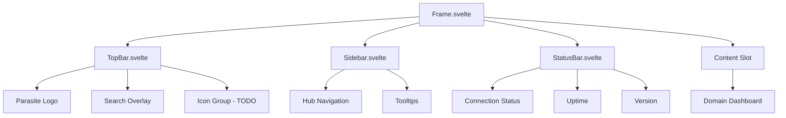
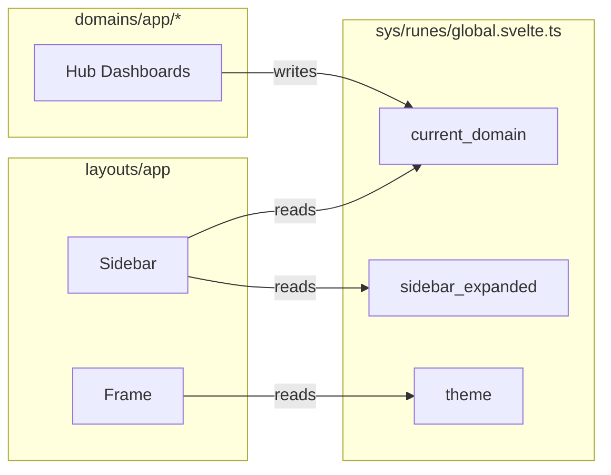

 # layouts/app

> **Status:** `IN_PROGRESS`
> **Version:** `0.1.0`
> **Last Updated:** `2026-01-22`
> **Layer:** `layouts`
> **Kind:** `shell`

---

## Overview

The **dumb shell** layout providing persistent navigation, status indicators, and content framing for all four hubs. **No business logic** — only presentational components with minimal UI state.

```
┌──────────────────────────────────────────────────────────────────┐
│ TOPBAR (100%)                                                    │
│ ParasiteLogo │ ─ spacer ─ │ [search] [user] [web] [notifications]│
├────────┬─────────────────────────────────────────────────────────┤
│ SIDEBAR│ CONTENT AREA                                            │
│ 64px   │ (scrollable, hub dashboards render here)                │
│ icons  │                                                         │
│ only   │                                                         │
├────────┴─────────────────────────────────────────────────────────┤
│ STATUSBAR (100%)                                                 │
│ [●] online │ ─ uptime ─ │ v0.1.0                                 │
└──────────────────────────────────────────────────────────────────┘
```

### Hubs Powered

| Hub | Route | Purpose |
|-----|-------|---------|
| **DevPulse** | `/devpulse` | Global overview, entry point, community |
| **OverMind** | `/overmind` | Ephemeral sandbox, theorycrafting |
| **DevForge** | `/devforge` | Active project workspace |
| **WiredFront** | `/wiredfront` | Media capture, gallery, editing |

---

## Architecture

### CSS Grid Specification

```css
grid-template-rows: 48px 1fr 32px;
grid-template-columns: 64px 1fr;
grid-template-areas:
    "topbar  topbar"
    "sidebar content"
    "status  status";
```

### Component Flow



### State Contract



---

## Engine Facade Integration

> **ADR-PENDING**: All engine communication flows through the facade pattern.

### Rules

1. **No direct Tauri commands** from layout components
2. **Event bus pattern** for status updates
3. **Type alignment** with `systems/engine` bindings

### Tauri Commands (Reference)

| Command | Source | Consumer |
|---------|--------|----------|
| `get_connection_status` | Engine | StatusBar |
| `get_system_uptime` | Engine | StatusBar |
| `get_vram_usage` | Engine | StatusBar (future) |

### Event Bus (Planned)

```typescript
// Events layout components may LISTEN to (never emit)
interface ShellEvents {
    'engine:connection-change': { status: 'online' | 'offline' | 'hybrid' };
    'engine:telemetry-update': { vram: number; uptime: string };
}
```

---

## Component Inventory

### Stateful Components (6 Allowed)

Only these components may have local `$state()`:

| Component | Runes | Purpose |
|-----------|-------|---------|
| `TopBar.svelte` | `$state()` | Search overlay toggle |
| `Sidebar.svelte` | `$state()` | Hover/animation state |
| `StatusBar.svelte` | `$state()` | Status indicator state |
| `Avatar.svelte` | `$state()` | User menu toggle (TODO) |
| `Logo.svelte` | `$state()` | Interaction animations (TODO) |
| `Status.svelte` | `$state()` | Detailed status popover (TODO) |

### Current Status

| Component | Status | TSDoc | Tests | Notes |
|-----------|--------|-------|-------|-------|
| `Frame.svelte` | SCAFFOLD | TODO | - | Grid shell, `$props()` only |
| `TopBar.svelte` | PARTIAL | TODO | - | Missing icon group |
| `Sidebar.svelte` | PARTIAL | TODO | - | Missing expand/collapse |
| `StatusBar.svelte` | SCAFFOLD | TODO | - | Hardcoded values |
| `index.ts` | EMPTY | - | - | No exports |

---

## TruClamp Utility

> **Location:** `layouts/app/utils/truclamp.ts`

A CSS utility for clamping values with enhanced control.

```typescript
/**
 * @file layouts/app/utils/truclamp.ts
 * @layer layouts
 * @kind utility
 *
 * TruClamp - Enhanced CSS clamping utility for layouts
 *
 * @example
 * const width = truclamp(200, '15vw', 400); // min, preferred, max
 *
 * @since 0.1.0
 */
export function truclamp(min: number, preferred: string, max: number): string {
    return `clamp(${min}px, ${preferred}, ${max}px)`;
}
```

---

## Data Attributes Contract

All shell components MUST use these data attributes:

```html
<!-- Frame -->
<div data-layout="app" data-route="{current_domain}">

<!-- TopBar -->
<header data-slot="topbar">

<!-- Sidebar -->
<aside data-slot="sidebar" data-expanded="{boolean}">

<!-- StatusBar -->
<footer data-slot="statusbar">

<!-- Content -->
<main data-slot="content">
```

---

## Token Dependencies

```css
/* ========== REQUIRED TOKENS ========== */

/* Spacing */
--space-1, --space-2, --space-3, --space-4

/* Surfaces */
--surface-glass-void    /* TopBar, StatusBar background */
--surface-glass-deep    /* Sidebar background */
--surface-glass-smoke   /* Icon button default */
--surface-glass-frost   /* Icon button active */
--color-void            /* Frame background */

/* Borders */
--border-subtle, --border-soft, --border-medium

/* Effects */
--bevel-outset-subtle, --bevel-outset-soft, --bevel-outset-medium
--bevel-inset-soft
--shadow-z3, --shadow-z4, --shadow-glow-teal
--blur-lg, --blur-xl

/* Typography */
--text-white, --text-secondary, --text-muted
--text-xs, --text-sm
--font-sans, --font-mono

/* Signals */
--signal-teal, --signal-success, --signal-error

/* Animation */
--duration-fast, --duration-normal
--ease-out, --ease-in-out, --ease-bounce

/* Radius */
--radius-md, --radius-lg, --radius-full
```

---

## File Structure

```
layouts/app/
├── README.md           # This file
├── CHECKLIST.md        # Quality gates
├── index.ts            # Barrel exports (TODO)
├── Frame.svelte        # CSS Grid shell (SSOT)
├── TopBar.svelte       # Persistent header
├── Sidebar.svelte      # Icon navigation
├── StatusBar.svelte    # Persistent footer
├── AppLayout.svelte    # (REMOVE - duplicate)
├── utils/
│   └── truclamp.ts     # TruClamp utility (TODO)
└── components/
    └── shell/          # (REMOVE - consolidate to root)
        ├── Frame.svelte
        ├── Sidebar.svelte
        └── TopBar.svelte
```

> **Action:** Delete `components/shell/` and `AppLayout.svelte` after confirming root versions are canonical.

---

## Usage

```svelte
<!-- +layout.svelte -->
<script lang="ts">
    import { Frame } from '$lib/layouts/app';
</script>

<Frame>
    {@render children()}
</Frame>
```

---

## ADR References

| ADR | Status | Title |
|-----|--------|-------|
| ADR-001 | PENDING | Shell state isolation pattern |
| ADR-002 | PENDING | Engine facade communication |
| ADR-003 | PENDING | Z-index layering system |

---

## Related

| Resource | Path | Purpose |
|----------|------|---------|
| GlobalState | `lib/sys/runes/global.svelte.ts` | Shared state singleton |
| Parasite Logo | `lib/design/plugins/parasite` | Brand typography |
| Chat Overlay | `layouts/chat/README.md` | Floating chat layer |
| Hub Hierarchy | `HUB_ROUTE_HIERARCHY.md` | Navigation spec |
| ColdLight | `lib/design/` | Design system tokens |

---

## Changelog

| Version | Date | Changes |
|---------|------|---------|
| 0.1.0 | 2026-01-22 | Initial scaffold with CSS Grid layout |
/**
 * @file layouts/app/styles/shell.css
 * @layer layouts
 *
 * CSS Grid Shell Layout
 * Consumes ColdLight tokens via var(--*) references.
 *
 * Grid:
 * ┌──────────────────────────────────────────┐
 * │ TOPBAR (100%)                            │
 * ├────────┬─────────────────────────────────┤
 * │ SIDEBAR│ CONTENT AREA                    │
 * │ 64px   │ (scrollable)                    │
 * ├────────┴─────────────────────────────────┤
 * │ STATUSBAR (100%)                         │
 * └──────────────────────────────────────────┘
 *
 * @since 0.1.0
 */

[data-layout="app"] {
	display: grid;
	width: 100%;
	height: 100%;
	overflow: hidden;
	grid-template-rows: clamp(40px, 5vh, 56px) 1fr clamp(24px, 3vh, 32px);
	grid-template-columns: clamp(48px, 5vw, 64px) 1fr;
	grid-template-areas:
		"topbar  topbar"
		"sidebar content"
		"status  status";
	gap: 4px;
}

[data-layout="app"][data-sidebar="expanded"] {
	grid-template-columns: clamp(200px, 20vw, 280px) 1fr;
}

[data-slot="topbar"] {
	grid-area: topbar;
	display: flex;
	align-items: center;
	padding: 0 var(--space-3);
	gap: var(--space-3);
	min-height: 0;
}

[data-slot="sidebar"] {
	grid-area: sidebar;
	display: grid;
	grid-template-rows: 1fr auto;
	align-content: start;
	justify-items: end;
	padding: var(--space-3) var(--space-2) var(--space-2);
	gap: var(--space-2);
	min-width: 0;
	overflow-y: auto;
	overflow-x: hidden;
}

[data-layout="app"][data-sidebar="expanded"] [data-slot="sidebar"] {
	justify-items: stretch;
}

[data-slot="content"] {
	grid-area: content;
	min-width: 0;
	min-height: 0;
	overflow: auto;
	position: relative;
}

[data-slot="statusbar"] {
	grid-area: status;
	display: flex;
	align-items: center;
	justify-content: space-between;
	padding: 0 var(--space-3);
	min-height: 0;
}

[data-slot="content"]::-webkit-scrollbar {
	width: 6px;
}

[data-slot="content"]::-webkit-scrollbar-track {
	background: var(--color-void-900);
	border-radius: 3px;
}

[data-slot="content"]::-webkit-scrollbar-thumb {
	background: var(--color-teal-600);
	border-radius: 3px;
	box-shadow: 0 0 4px color-mix(in oklch, var(--color-teal-500), transparent 70%);
}

[data-slot="content"]::-webkit-scrollbar-thumb:hover {
	background: var(--color-teal-500);
	box-shadow: 0 0 8px color-mix(in oklch, var(--color-teal-500), transparent 50%);
}
