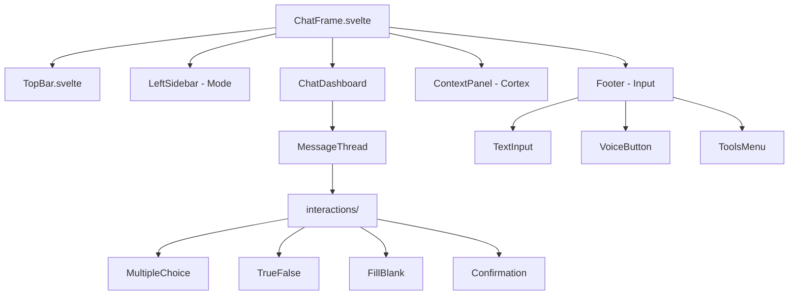
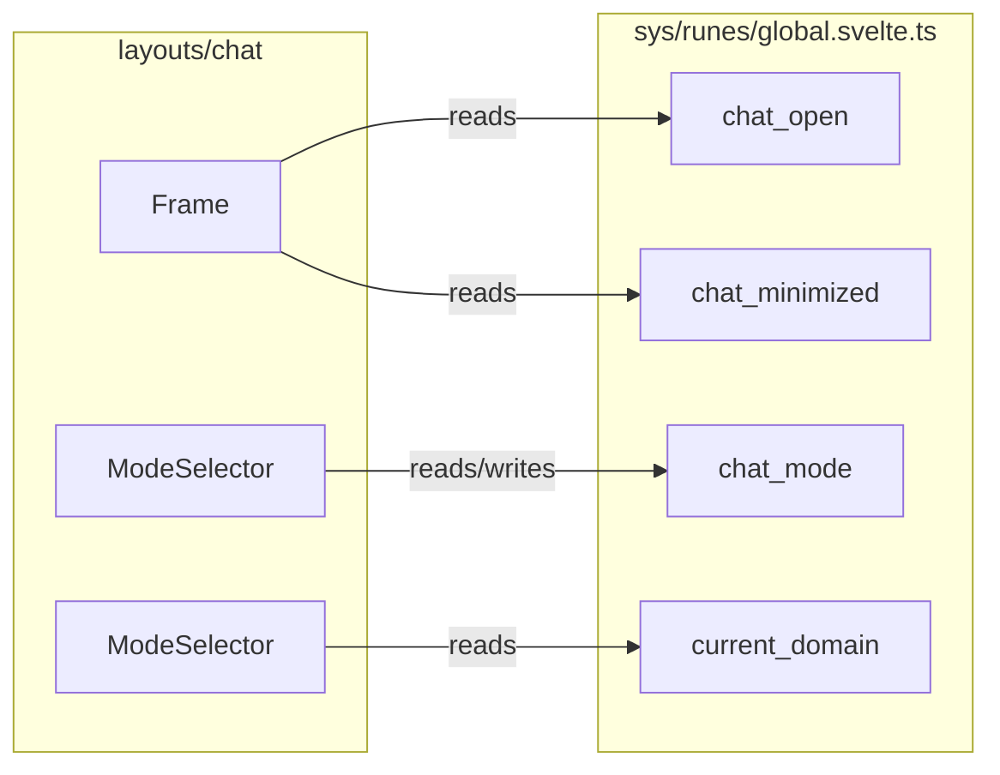

# layouts/chat

> **Status:** `SCAFFOLD`
> **Version:** `0.1.0`
> **Last Updated:** `2026-01-22`
> **Layer:** `layouts`
> **Kind:** `overlay`

---

## Overview

The **true window** chat overlay that floats above all hubs. Provides persistent AI interaction regardless of which hub the user is in. Features an **interactions folder** with beautiful components for AI to easily populate user responses.

### Design References

| Reference | Description |
|-----------|-------------|
| `CHAT-REFERENCE-01.png` | Dark glass with cyan accents, cortex visualization |
| `CHAT-REFERENCE-02.png` | Purple variant with interactive checkboxes |

```
┌──────────────────────────────────────────────────────────────────┐
│ [Hub Content - DevPulse/OverMind/DevForge/WiredFront]            │
│                                                                  │
│  ┌────────────────────────────────────────────────────────────┐  │
│  │ DEVPULSE/HQ │ CORTEX MEMORY                                │  │
│  ├──────┬─────────────────────────────────────────────────────┤  │
│  │ MODE │ Chat Thread                        │ Network Graph  │  │
│  │ ──── │ ─────────────────────────          │ (Cortex Viz)   │  │
│  │ DEV  │ Gus_AI: Message...                 │                │  │
│  │ PLAN │                                    │    ○───○       │  │
│  │ IMG  │ ┌────────────────────────┐         │   /│\ /│\      │  │
│  │ GEN  │ │ □ Option A             │         │  ○ ○ ○ ○       │  │
│  │      │ │ □ Option B             │         │                │  │
│  │      │ │ □ Option C             │         │                │  │
│  │      │ └────────────────────────┘         │                │  │
│  ├──────┴───────────────────────────┬────────┴────────────────┤  │
│  │ Type message...                  │ [🎤 Voice Active]       │  │
│  └──────────────────────────────────┴─────────────────────────┘  │
└──────────────────────────────────────────────────────────────────┘
```

### Key Behaviors

- **True window** - Separate layer, not embedded in app shell
- **Glass aesthetic** - Matches ColdLight design system
- **30-40% transparent when idle** - Click-through when not engaged
- **MODE selector** - Left sidebar with DEVELOPER | PLANNING | IMAGE | GENERAL
- **Cortex visualization** - Right panel shows memory/context graph
- **Voice button always visible** - Bottom right corner
- **Interactions folder** - Structured components for AI responses

---

## Architecture

### Z-Index Layering

```
z-1000+ : Chat Overlay (this)
z-100   : TopBar, StatusBar (layouts/app)
z-0     : Content area (domains/*)
```

### Component Flow



### State Contract



---

## Interactions Folder

> **Location:** `layouts/chat/components/interactions/`

Beautiful, accessible components for AI to populate user responses. The AI generates structured data, these components render it.

### MultipleChoice.svelte

```typescript
interface MultipleChoiceProps {
    question: string;
    options: Array<{
        id: string;
        label: string;
        description?: string;
    }>;
    selected?: string[];
    multiSelect?: boolean;
    onSelect: (ids: string[]) => void;
}
```

**Visual:**
```
┌─────────────────────────────────────┐
│ Which database should we use?       │
│                                     │
│  ○ PostgreSQL                       │
│    Full-featured relational DB      │
│                                     │
│  ● SurrealDB (selected)             │
│    Multi-model with graph support   │
│                                     │
│  ○ SQLite                           │
│    Lightweight, embedded            │
└─────────────────────────────────────┘
```

### TrueFalse.svelte

```typescript
interface TrueFalseProps {
    statement: string;
    context?: string;
    value?: boolean | null;
    onChange: (value: boolean) => void;
}
```

**Visual:**
```
┌─────────────────────────────────────┐
│ Should we add authentication first? │
│                                     │
│  [✓ Yes]     [ No ]                 │
└─────────────────────────────────────┘
```

### FillBlank.svelte

```typescript
interface FillBlankProps {
    prompt: string;
    blanks: Array<{
        id: string;
        placeholder: string;
        type: 'text' | 'number' | 'select';
        options?: string[]; // for select type
    }>;
    values: Record<string, string>;
    onChange: (values: Record<string, string>) => void;
}
```

**Visual:**
```
┌─────────────────────────────────────┐
│ Configure the API endpoint:         │
│                                     │
│ Base URL: [https://api.______]      │
│ Port:     [8080_____________]       │
│ Version:  [v1 ▼]                    │
└─────────────────────────────────────┘
```

### Confirmation.svelte

```typescript
interface ConfirmationProps {
    title: string;
    message: string;
    confirmLabel?: string;
    cancelLabel?: string;
    variant?: 'default' | 'destructive' | 'success';
    onConfirm: () => void;
    onCancel: () => void;
}
```

---

## Mode Availability by Hub

| Hub | DEVELOPER | PLANNING | IMAGE | GENERAL |
|-----|-----------|----------|-------|---------|
| **DevPulse** | - | - | - | default |
| **OverMind** | - | default | - | yes |
| **DevForge** | default | yes | yes | yes |
| **WiredFront** | - | - | default | yes |

### Mode Descriptions

| Mode | Weight | Purpose |
|------|--------|---------|
| **DEVELOPER** | Heavy | Production prompts, full COSTAR+, verification gates |
| **PLANNING** | Light | Ephemeral exploration, sprint planning |
| **IMAGE** | Medium | Visual context, screenshot-driven, SigLIP2 |
| **GENERAL** | None | Dumping ground, never taints project context |

---

## Component Inventory

### shell/

| Component | Status | Purpose |
|-----------|--------|---------|
| `Frame.svelte` | STUB | Floating overlay container |
| `ChatDashboard.svelte` | STUB | Main chat thread view |
| `TopBar.svelte` | STUB | Hub tabs, minimize, close |
| `LeftSidebar.svelte` | STUB | Mode selector sidebar |
| `QuickMenu.svelte` | STUB | Tools quick-access menu |

### panels/

| Component | Status | Purpose |
|-----------|--------|---------|
| `ContextPanel.svelte` | STUB | Cortex memory visualization |
| `HistoryPanel.svelte` | STUB | Conversation thread history |
| `StatusBar.svelte` | STUB | Chat-specific status |
| `Footer.svelte` | STUB | Input area + voice + tools |

### overlays/

| Component | Status | Purpose |
|-----------|--------|---------|
| `CommandPalette.svelte` | STUB | Cmd+K command interface |
| `ModeSelector.svelte` | STUB | Mode switching dropdown |

### interactions/ (NEW)

| Component | Status | Purpose |
|-----------|--------|---------|
| `MultipleChoice.svelte` | TODO | Radio/checkbox selection |
| `TrueFalse.svelte` | TODO | Binary yes/no choice |
| `FillBlank.svelte` | TODO | Text input with blanks |
| `Confirmation.svelte` | TODO | Action confirmation dialog |
| `index.ts` | TODO | Barrel exports |

---

## Engine Facade Integration

> **ADR-PENDING**: Chat communicates with Maestro via event bus.

### Rules

1. **No direct Tauri commands** from chat components
2. **Event bus pattern** for AI communication
3. **Type alignment** with Maestro kernel types

### Events (Chat → Maestro)

```typescript
interface ChatOutboundEvents {
    'chat:message-send': { content: string; mode: ChatMode };
    'chat:mode-change': { mode: ChatMode };
    'chat:interaction-response': { interactionId: string; value: unknown };
    'chat:voice-start': void;
    'chat:voice-end': { audio: Blob };
}
```

### Events (Maestro → Chat)

```typescript
interface ChatInboundEvents {
    'maestro:message-receive': { content: string; author: 'gus' | 'system' };
    'maestro:interaction-request': InteractionRequest;
    'maestro:thinking-start': void;
    'maestro:thinking-end': void;
    'maestro:cortex-update': CortexVisualization;
}
```

---

## Data Attributes Contract

```html
<!-- Frame -->
<div data-layout="chat" data-state="open|minimized|closed">

<!-- Mode Selector -->
<nav data-slot="mode-selector" data-mode="{current_mode}">

<!-- Chat Dashboard -->
<main data-slot="chat-dashboard">

<!-- Interaction Components -->
<div data-interaction="multiple-choice|true-false|fill-blank|confirmation">

<!-- Message -->
<article data-message data-author="user|gus|system">
```

---

## Token Dependencies

Inherits from `layouts/app` plus:

```css
/* ========== CHAT-SPECIFIC TOKENS ========== */

/* Opacity states */
--chat-idle-opacity: 0.35
--chat-engaged-opacity: 1

/* Z-index */
--chat-z-index: 1000
--chat-overlay-z: 1001

/* Positioning */
--chat-bottom: var(--space-4)
--chat-right: var(--space-4)
--chat-width: 400px
--chat-min-width: 320px
--chat-max-width: 600px
--chat-height: 60vh
--chat-min-height: 400px

/* Mode colors */
--mode-developer: var(--signal-teal)
--mode-planning: var(--signal-purple)
--mode-image: var(--signal-orange)
--mode-general: var(--text-muted)

/* Voice indicator */
--voice-active: var(--signal-success)
--voice-pulse: 0 0 12px var(--signal-success)
```

---

## File Structure

```
layouts/chat/
├── README.md               # This file
├── CHECKLIST.md            # Quality gates
├── index.ts                # Barrel exports
└── components/
    ├── shell/
    │   ├── ChatDashboard.svelte
    │   ├── Frame.svelte
    │   ├── LeftSidebar.svelte
    │   ├── QuickMenu.svelte
    │   └── TopBar.svelte
    ├── panels/
    │   ├── ContextPanel.svelte
    │   ├── Footer.svelte
    │   ├── HistoryPanel.svelte
    │   └── StatusBar.svelte
    ├── overlays/
    │   ├── CommandPalette.svelte
    │   └── ModeSelector.svelte
    ├── interactions/       # NEW
    │   ├── index.ts
    │   ├── MultipleChoice.svelte
    │   ├── TrueFalse.svelte
    │   ├── FillBlank.svelte
    │   └── Confirmation.svelte
    └── notify/
        └── (empty - use domains/notify)
```

---

## State Dependencies

```typescript
// Additions to global.svelte.ts
class GlobalState {
    // Existing
    current_domain = $state("devpulse");

    // Chat state
    chat_open = $state(false);
    chat_minimized = $state(false);
    chat_mode = $state<'developer' | 'planning' | 'image' | 'general'>('general');
    chat_transparency = $state(0.35);

    // Methods
    toggleChat() { this.chat_open = !this.chat_open; }
    setMode(mode: ChatMode) { this.chat_mode = mode; }
    minimizeChat() { this.chat_minimized = true; }
}
```

---

## ADR References

| ADR | Status | Title |
|-----|--------|-------|
| ADR-004 | PENDING | Chat overlay z-index layering |
| ADR-005 | PENDING | Mode availability rules |
| ADR-006 | PENDING | Interaction component contracts |
| ADR-007 | PENDING | Maestro event bus protocol |

---

## Related

| Resource | Path | Purpose |
|----------|------|---------|
| App Shell | `layouts/app/README.md` | Renders underneath |
| Chat Domain | `domains/chat/` | Business logic |
| Maestro | `domains/maestro/` | AI interface |
| GlobalState | `sys/runes/global.svelte.ts` | Shared state |
| Reference 01 | `design/REFERENCES/CHAT-REFERENCE-01.png` | Design spec |
| Reference 02 | `design/REFERENCES/CHAT-REFERENCE-02.png` | Design spec |

---

## Changelog

| Version | Date | Changes |
|---------|------|---------|
| 0.1.0 | 2026-01-22 | Initial scaffold with interactions folder spec |
