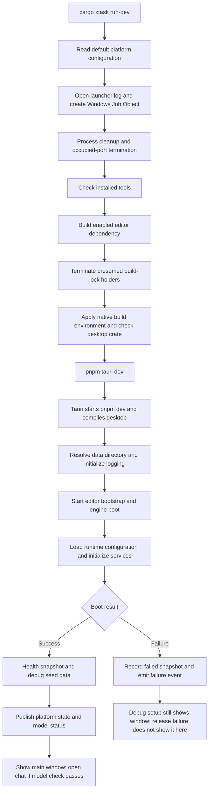

# Research: Reliable local desktop development

Date: 2026-09-25
Status: Code investigation complete for initial planning; runtime baseline NOT verified.
Plan: [Acceptance and phased work](SPRINT-DEV-RELIABILITY.md)

## Goal and scope

Make the existing Rust launcher reproduce a real desktop development and test environment. Investigate prerequisites, configuration, process ownership, boot readiness, persistent data, diagnostics, and shutdown before implementation. This document records evidence, not approval of architectural changes.

Repository: `D:/localdev/platform_devpulse`. Inspected branch: `wip/2026-09-23-session`, HEAD `1921fc48`. Existing local changes include Tauri configuration and generated schemas; they must be preserved. No application source was changed during this investigation.

The local health endpoint on port 8822 was unreachable, so database context was unavailable. File-based context was used. Referenced `.Codex` policy files were absent; corresponding `.claude` policy and mistake files were available. Older sprint descriptions are historical intent, not runtime evidence.

## Evidence levels

- **Executed:** command outcome observed in this conversation.
- **Code:** behavior visible in the current implementation; not reproduced in a running desktop session.
- **Unverified:** requires a build, runtime experiment, or further targeted inspection.

## Existing authorities and competing definitions

Paths below are relative to the repository root.

| Concern | Current source | Finding |
| --- | --- | --- |
| Rust toolchain | `rust-toolchain.toml` | Pins 1.89.0 with formatter, linter, and analyzer. Compatibility with the full desktop dependency graph remains unverified. |
| Node and package manager | `.nvmrc`, root `package.json` | Node major 22; pnpm 10.29.3. |
| Workspace packages | `pnpm-workspace.yaml` | Includes desktop and documentation tooling. Root and desktop lockfiles both exist; authoritative install behavior needs a controlled check before removing any lockfile. |
| Native build configuration | `.cargo/config.toml`, `systems/devpulse-engine/platform.default.toml` | Cargo selects dynamic CRT; platform TOML declares static CRT. The launcher prints that declaration but does not apply it as a compiler switch. Resolve authority before changing either. |
| Launcher configuration | `xtask/src/workspace.rs` | `PlatformConfig` reads the default TOML from disk and exposes a subset of its fields. |
| Runtime configuration | `systems/devpulse-engine/src/platform/config.rs` | `PlatformBootConfig::load` uses a data-directory `platform.toml` as replacement input; otherwise parses embedded defaults. This differs from launcher configuration selection. |
| Frontend address | `interfaces/desktop/vite.config.ts`, `interfaces/desktop/src-tauri/tauri.conf.json` | Vite accepts an environment port with fallback 1420; Tauri has a fixed localhost URL. The advertised preflight URL validation is absent from the inspected preflight implementation. |
| Desktop features | `interfaces/desktop/src-tauri/Cargo.toml`, Tauri config | Feature selection exists in multiple places. Baseline verification must record effective features, not just command names. |
| Boot snapshot | `interfaces/desktop/src-tauri/src/state.rs` | `BootSnapshot` contains phase, service events, health, and error; no model-readiness fields. |
| Frontend readiness | `interfaces/desktop/src/lib/sys/runes/platformState.svelte.ts` | Separate platform and model state; snapshot fetched before listeners register. |
| Service validation | `systems/devpulse-engine/src/platform/boot/mod.rs` | Critical-service validation followed by a global failure-count gate. These implement conflicting failure policies. |

These are consolidation candidates, not authorization for a new shared configuration crate or a broad refactor. Preserve the engine facade boundary. Prefer a narrow, explicit contract over pulling the runtime dependency graph into the development launcher.

## Current startup map

The map follows implementation, not comments. `boot_task` returns unit and handles its error internally. Setup therefore does not propagate that failure as a Tauri setup error. Release mode also starts with a hidden main window; comments claiming immediate visibility do not match this path.

## Executed observations

| Check | Result | Limit |
| --- | --- | --- |
| `cargo check -p xtask --locked` | Passed with zero errors | Checks launcher only, not desktop or engine. |
| `cargo xtask preflight` | Failed: pnpm not found in PATH | Describes this execution environment, not proof that pnpm is absent everywhere on the machine. |
| Installed `svelte-check.cmd --output human` | Failed before checking source: missing `readdirp` | Installed dependency tree is unusable for this check; no frontend error count established. |
| Local port 8822 health request | Unreachable | No runtime memory loaded; no desktop health claim. |

Desktop compilation, native linking, packaging, live IPC, persistence, and recovery have NOT been verified.

## Findings and reliability implications

1. **Startup acts before validating prerequisites.** `xtask/src/commands/dev.rs` invokes cleanup and port termination before preflight. A missing tool can therefore fail after unrelated work has already been interrupted.
2. **Cleanup does not prove ownership.** `xtask/src/zombie.rs` scans process names and build executables; the Windows build cleanup excludes ancestors but can terminate other cargo/rustc processes. `xtask/src/net.rs` terminates a listener by port. Neither is evidence that the process belongs to this session.
3. **Containment is best-effort.** Job Object creation and assignment failures are warnings. Assignment occurs after spawning. Process-tree containment and graceful Ctrl+C behavior require live tests; comments promising universal cleanup are not sufficient.
4. **Verification differs from launch.** `xtask/src/commands/verify.rs` runs `cargo check --workspace` without applying the native build environment. It must use the intended desktop crate and the same resolved build inputs. Spawn-failure cleanup also needs coverage when one checker starts and the other cannot.
5. **Prerequisite checks are shallow.** Preflight checks that `.bin` exists, resolves tools, and warns on version mismatch. It does not demonstrate dependency integrity, native tools, linker readiness, or matching development addresses.
6. **Configuration can diverge.** Launcher defaults, runtime overrides, Vite environment input, Tauri URL, and CRT declarations can disagree. A session needs a recorded effective configuration and a tested precedence contract.
7. **Failure policy contradicts itself.** Critical validation permits a configured degraded path, but `boot_log.has_failures()` later fails the entire boot. The graph HTTP startup path even labels its failure non-fatal while recording a boot failure. Decide the policy before modifying gates.
8. **Readiness is not just successful construction.** After boot, desktop queries health and calls `tracker.set_ready` without an explicit health-status rejection in that branch. The tracker is marked ready before managed platform state is installed. Model readiness checks nonempty registry and at least one assignment, not a successful inference request.
9. **Frontend catch-up is incomplete.** Fetching a snapshot before registering listeners leaves a timing gap. The inspected snapshot cannot replay model status. Runtime tests must cover early events, late mount, reload, and remount; this does not establish that every frontend consumer lacks an independent recovery path.
10. **Data isolation is not a supported launcher selection today.** Desktop debug mode resolves repository `.userdata`; release uses an existing adjacent portable directory or OS app data. Debug boot also seeds data. A fresh-profile test must not reset the developer's normal data.
11. **Shutdown has only a partial deadline.** Tauri handles Exit by stopping the editor sidecar and then calling platform shutdown. Platform shutdown has a five-second service budget; the earlier sidecar stop is outside that budget. Forced Job Object termination is not proof of a completed flush. Background task and listener ownership require further inspection.
12. **Diagnostics have lifecycle gaps.** Launcher log overwrites the previous session and writes its completion footer before running Tauri. Session JSON logs exist, but their worker guard is deliberately forgotten. Final flush, correlated session identity, rotation invocation, and error retention need verification.

## Related plans and documentation drift

`SPRINT-BOOT-HALT-WIZARD.md` and `SPRINT-BOOT-WIZARD-FIX.md` cover onboarding behavior and remain marked as plans. Current `BootOverlay.svelte` opens a shell-mounted setup overlay when platform boot succeeds but models need setup. Do not implement the historical full-screen design merely because an older sprint describes it.

The workspace editor file points to another directory; treat debugger launch setup as unverified. `xtask/README.md` describes a second application launching, while the inspected launcher starts the desktop. A second application is not added to this baseline without explicit scope approval.

## Recommended direction

Keep the existing Rust entry point. First repair and verify prerequisites, then make launcher operations safe, then establish one effective configuration contract, then reconcile boot/readiness and shutdown semantics. Test fresh and existing profiles, followed by a packaged build. Preserve a distinction between platform availability, setup requirements, and verified model execution.

No external research was needed to establish these repository findings. Before implementation depends on version-specific Tauri or Windows lifecycle behavior, validate it against the installed source and official documentation. Do not treat this document as an API specification.

## Open evidence gaps

- Full effective feature graph, native library/linker versions, and repeatable dependency installation.
- Which enabled capabilities must be mandatory for the owner's baseline.
- Actual health endpoint coverage versus whole-platform health.
- Cancellation and joining of background tasks, failed-boot resource release, and sidecar stop bounds.
- Migration behavior, interrupted writes, model setup recovery, and packaged portable-path behavior.
- Measured boot and shutdown durations on this machine; no performance promise has been established.
