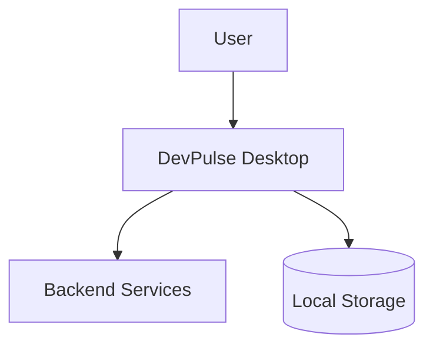

# Architecture

> **Status**: Draft
> **Last Updated**: [DATE]

## Overview

[High-level description of the system architecture]

## System Context

## Layers

### Route Layer
- Thin adapters only
- No feature logic
- Imports from domain index.ts

### Domain Layer
- Feature-specific business logic
- State management (*.state.svelte.ts)
- Services (*.svc.ts)
- Public API via index.ts

### System Layer
- Platform-wide utilities
- Contracts and registries
- Generated files (routes, types)
- Streams boundary

## Key Design Decisions

See [Architecture Decision Records](./adr/) for detailed rationale.

## Data Flow

1. User interacts with Route component
2. Route renders Domain page component
3. Domain component uses State module
4. State module calls Services
5. Services interact with System layer

## Technology Stack

- **Frontend**: SvelteKit 5 + Svelte 5 (runes)
- **Desktop**: Tauri 2.0
- **State**: Svelte 5 runes ($state, $derived)
- **Styling**: [Design system]

## Security Considerations

[Security architecture notes]

## Performance Considerations

[Performance architecture notes]
